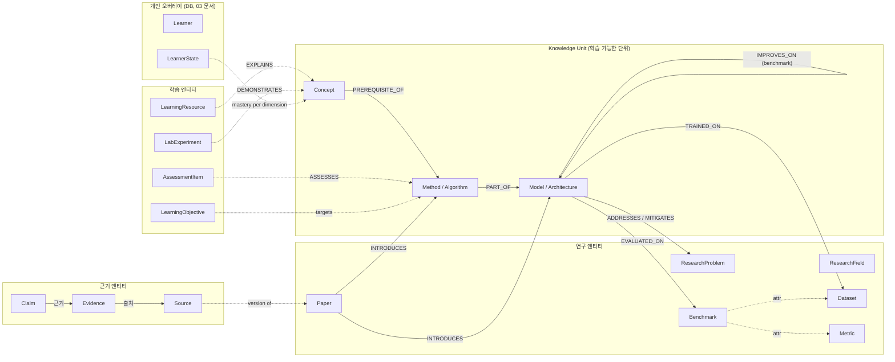
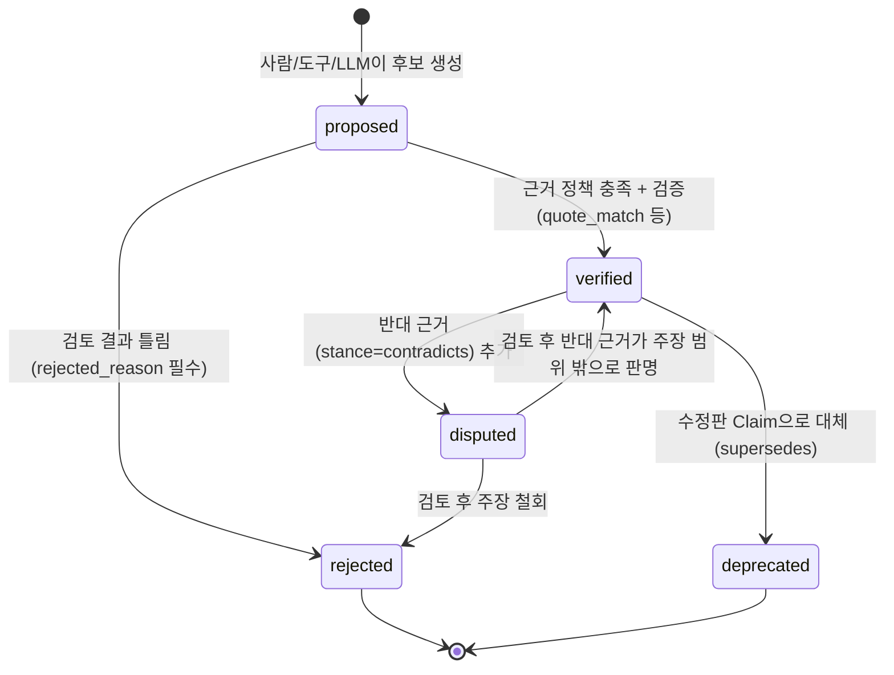

# 02. Domain Ontology & Knowledge Graph Design

> AIXON(구 Neural Atlas)의 지식 표현 규칙. 이 문서가 엔티티·관계의 **의미의 원천**이다.
> 저장 형식은 [03_DATA_MODEL.md](03_DATA_MODEL.md), 관계를 쓰는 알고리즘은 [04_LEARNING_ENGINE.md](04_LEARNING_ENGINE.md), 실제 데이터는 [data/seed/seed_graph.yaml](../data/seed/seed_graph.yaml).
> 작성 2026-10-15 · 상태: MVP 설계안 v1

---

## 1. 설계 원칙

| # | 원칙 | 이 문서에서의 구체화 |
|---|---|---|
| O1 | **세상에 대한 주장과 편집 결정을 구분한다** | "ViT는 Transformer를 비전에 적용했다"는 **Claim**(근거 필수). "이 퀴즈는 softmax 설명 능력을 평가한다"는 **Editorial Link**(작성자 결정, 근거 불필요). §7 |
| O2 | **연구 관계 ≠ 선수 관계** | Research Graph 술어(EXTENDS 등)와 Prerequisite 술어(PREREQUISITE_OF 등)는 정의역·치역·근거 정책이 다르다. 한쪽에서 다른 쪽을 자동 추론하지 않는다. §6 |
| O3 | **CITES는 영향이 아니다** | 인용은 서지 사실일 뿐이다. EXTENDS·ADAPTS·IMPROVES_ON은 저자 진술이나 실험 결과를 따로 근거로 요구한다. |
| O4 | **술어는 적게, 의미는 좁게** | 각 술어에 "판별 질문"을 둔다(§8). 의미가 겹치면 하나를 없앤다. RELATED_TO는 학습 경로 계산에 쓰지 않는다. |
| O5 | **선수 관계는 학습 목표 수준에 묶인다** | 선수 관계는 `(단위, 역량 차원)` 쌍 사이의 관계다. "softmax를 알아야 attention을 안다" 같은 무조건 관계는 쓰지 않는다. §5 |
| O6 | **Verified와 Proposed를 섞지 않는다** | 계획 알고리즘은 `verified`만 쓴다. `proposed`는 화면에 표시만 하며 기본값은 숨김이다. |
| O7 | **식별자는 불변이다** | 사람이 읽을 수 있는 타입 접두 slug를 쓰고, 한 번 정하면 바꾸지 않는다. 병합·분리는 tombstone으로 기록한다. |

---

## 2. 엔티티 지도



실선은 **Claim**(근거가 필요한 관계), 점선은 **Editorial Link** 또는 속성이다.

**Knowledge Unit (KU)** 은 Concept, Method, Model을 묶어 부르는 이름이다. 공통 상위 타입이 아니고, 학습 경로의 노드가 될 수 있는 타입을 함께 가리키는 말이다. 저장할 때 세 타입은 따로 구분한다. 각자 고유한 속성과 판별 기준이 있다(§4).

---

## 3. 식별자 규칙

### 3.1 형식

```
<type-prefix>:<slug>
slug    := [a-z0-9]+(-[a-z0-9]+)*      # kebab-case, ASCII
```

| 타입 | 접두사 | slug 규칙 | 예 |
|---|---|---|---|
| ResearchField | `field:` | 분야 영문명 | `field:computer-vision` |
| ResearchProblem | `problem:` | 문제의 핵심 명사구 | `problem:degradation-in-deep-networks` |
| Concept | `concept:` | 개념명 | `concept:softmax` |
| Method | `method:` | 기법명 | `method:scaled-dot-product-attention` |
| Model | `model:` | 모델 계열명(변형은 속성) | `model:vit` |
| Paper | `paper:` | `{제1저자 성}{최초 공개 연도}-{짧은 별칭}` | `paper:dosovitskiy2020-vit` |
| Dataset | `dataset:` | 데이터셋명 | `dataset:jft-300m` |
| Metric | `metric:` | 지표명 | `metric:top-1-accuracy` |
| Benchmark | `benchmark:` | `{dataset}-{task}` | `benchmark:imagenet-1k-classification` |
| LearningObjective | `lo:` | 목표 요지 | `lo:vit-attention-math` |
| LearningResource | `res:` | `{출처}-{주제}` | `res:d2l-attention-scoring` |
| AssessmentItem | `ai:` | `{단위}-{번호}` | `ai:softmax-01` |
| LabExperiment | `lab:` | 실험명 | `lab:softmax-temperature` |
| Source | `src:` | `{scheme}:{id}{version}` | `src:arxiv:2010.11929v2` |
| Claim | `clm:` | 주장 요지 | `clm:vit-adapts-transformer` |

규칙:
1. **불변**: 한 번 공개(publish)된 ID는 이름이 바뀌어도 그대로 둔다. 표시 이름은 `name`·`aliases`로 바꾼다.
2. **연도는 최초 공개 연도**: arXiv v1 공개 연도를 쓴다(ViT는 2020. ICLR 2021 게재는 `venue` 속성에 적는다). 기억하기 쉬운 연도와 다를 수 있으므로 `aliases`에 "ViT (ICLR 2021)" 같은 표기를 함께 넣는다.
3. **변형은 엔티티가 아니다(MVP)**: `ResNet-50`, `ViT-B/16`은 `model:resnet`, `model:vit`의 `variants` 속성에 둔다. 비교 주장에서는 qualifier(`subject_variant`)로 가리킨다. 변형별로 서로 다른 Claim이 많아지면 그때 엔티티로 올린다(재검토 조건).
4. **Claim ID**: 사람이 큐레이션한 Claim은 의미 있는 slug를 쓴다. 기계가 만든 Claim(예: 메타데이터에서 온 CITES)은 `clm:auto-` + `sha256(predicate|subject|object)`의 앞 12자리를 쓴다. 다시 실행해도 같은 ID가 나와야 한다(idempotency).

### 3.2 병합·분리 (tombstone)

- **병합**: 두 엔티티가 같은 대상으로 밝혀지면, 남길 쪽(survivor)에 식별자와 aliases를 옮긴다. 흡수된 쪽은 `status: merged`, `merged_into: <survivor>`만 남긴 tombstone이 된다. 참조는 tombstone을 거쳐 survivor로 이어진다. 원본 메타데이터 레코드는 수정하지 않는다(03 문서 §5).
- **분리(잘못된 병합 복구)**: 큐레이션 그래프가 git에 있으므로 1차 복구 수단은 해당 커밋을 `git revert` 하는 것이다. 병합 뒤에 추가된 Claim이 있으면 검증기의 W105(merged 엔티티 참조) 경고가 다시 연결할 Claim 목록을 보여 준다.
- tombstone은 삭제하지 않는다. 사용자 DB(학습 이력)가 옛 ID를 가리킬 수 있기 때문이다.

---

## 4. 엔티티 명세

공통 속성(모든 엔티티):

| 속성 | 필수 | 설명 |
|---|---|---|
| `id` | ✓ | §3 규칙 |
| `type` | ✓ | 아래 타입명 |
| `name` (Paper는 `title`) | ✓ | 표시 이름 |
| `aliases` | | 동의어·약어·다른 표기 |
| `summary` | ✓(KU·Problem·Field) | 1~3문장 정의. **AI가 쓴 요약이면 `summary_by`에 표시한다** |
| `fields` | | Editorial Link: 소속 ResearchField 목록 |
| `related` | | Editorial Link: `[{id, note}]`. note 필수 |
| `status` | | `active`(기본) · `deprecated` · `merged` |
| `merged_into` | merged일 때 ✓ | survivor ID |

### 4.1 ResearchField

- **정의**: 연구 공동체가 공유하는 문제·방법의 범위(예: Computer Vision, Natural Language Processing).
- **필수**: `name`, `summary`. **선택**: `parents`(SUBFIELD_OF, 여러 부모 허용), `external_ids.openalex`(OpenAlex Field/Subfield/Topic ID 매핑).
- **구분 기준**: ResearchProblem은 "풀어야 할 질문"이고 ResearchField는 "질문들이 모인 영역"이다. "Image classification"처럼 과제 이름인 것은 MVP에서 Field로 둔다(과제 엔티티 Task는 따로 만들지 않는다. §12 열린 문제).
- **관계**: `parents`(SUBFIELD_OF), 다른 엔티티의 `fields`(IN_FIELD) 대상.
- **사례**: `field:computer-vision` → parents `[field:artificial-intelligence]`. `field:vision-transformers` → parents `[field:computer-vision, field:deep-learning]`(다중 부모).
- **버전**: 분류 체계는 편집 결정이다. 부모를 바꾸어도 ID는 유지하고 git 이력으로 추적한다.

### 4.2 ResearchProblem

- **정의**: 특정 연구들이 해결하려 한 **구체적 장애물이나 연구 질문**. 질문 형태로 쓸 수 있어야 한다.
- **필수**: `name`, `summary`, `question`(한 문장 질문). **선택**: `fields`.
- **구분 기준**: Concept(예: vanishing gradient 현상)과 겹칠 수 있다. 판별 질문은 "누군가 이것을 **해결 대상**으로 명시했는가?"이다. 그렇다면 Problem, 지식 그 자체라면 Concept이다. 같은 현상이 둘 다일 수 있으며, 이때는 두 엔티티를 두고 `related`로 잇는다.
- **관계**: ADDRESSES·MITIGATES의 object.
- **사례**: `problem:degradation-in-deep-networks`(question: "왜 더 깊은 plain network가 오히려 학습 오차가 커지는가?"). ResNet 논문이 해결 대상으로 명시했다.
- **버전**: 질문 문구를 다듬어도 ID는 유지한다.

### 4.3 Concept (KU)

- **정의**: 수학적 대상·함수·연산·성질·현상·이론적 개념. "그것이 무엇인가"에 관한 **정의적 지식**이며 특정 모델 설계에 묶이지 않는다.
- **필수**: `name`, `summary`, `dimensions`(적용 가능한 역량 차원, §5). **선택**: `formula`(LaTeX), `estimated_minutes`(차원별), `fields`.
- **구분 기준**: §4.14의 판별 절차를 따른다.
- **관계**: PREREQUISITE_OF / RECOMMENDED_BEFORE / PART_OF / IS_A(KU↔KU). EXPLAINS·ASSESSES·DEMONSTRATES의 대상.
- **사례**: `concept:softmax`, `concept:dot-product`, `concept:variance-of-sum`, `concept:inductive-bias`, `concept:receptive-field`.
- **버전**: 정의를 크게 바꾸면(의미가 달라지면) 새 ID를 만들고 옛 것은 `deprecated`로 둔다. 표현만 다듬는 것은 같은 ID에서 한다.

### 4.4 Method / Algorithm (KU)

- **정의**: 모델을 **만들거나 학습시키는 절차·구성요소**(알고리즘, 층 종류, 정규화, attention 변형, 학습 기법). "어떻게 하는가"에 관한 지식이다. 여러 모델에서 다시 쓰일 수 있다.
- **필수**: `name`, `summary`, `dimensions`. **선택**: `formula`, `estimated_minutes`, `fields`.
- **구분 기준**: "모델 X가 Y를 사용한다"고 말할 수 있고 Y가 설계·학습상의 **선택지**라면 Method다. 순수한 수학 함수(softmax)는 Concept으로 둔다. Method는 보통 INTRODUCES의 object가 될 수 있다(출처 논문이 있다). 다만 출처 논문이 시드에 없어도 된다.
- **사례**: `method:scaled-dot-product-attention`, `method:multi-head-attention`, `method:residual-connection`, `method:batch-normalization`, `method:patch-embedding`, `method:relu`, `method:dropout`.
- **버전**: Concept과 같다.

### 4.5 Model / Architecture (KU)

- **정의**: **이름이 붙은 구체적 시스템 계열**. 정해진 구성(Method들의 조합)과 하이퍼파라미터 변형이 있고, 실험 결과가 보고된다.
- **필수**: `name`, `summary`, `dimensions`. **선택**: `variants`(예: `[ViT-B/16, ViT-L/16, ViT-H/14]`), `estimated_minutes`, `fields`.
- **구분 기준**: 변형 이름이나 보고된 결과(표의 행)가 있으면 Model이다. "Transformer encoder layer"처럼 여러 Model에 들어가는 블록은 Method다.
- **관계**: INTRODUCES의 object. EXTENDS·ADAPTS·IMPROVES_ON·COMPARED_WITH·EVALUATED_ON·TRAINED_ON의 subject. PART_OF의 object(구성요소를 가진다).
- **사례**: `model:alexnet`, `model:vgg`, `model:resnet`, `model:transformer`, `model:bert`, `model:bit`, `model:vit`, `model:deit`, `model:swin`.

### 4.6 Paper

- **정의**: 하나의 **저작(work)**. 같은 저자·같은 핵심 기여를 담은 arXiv 버전, 학회 버전, 저널 재게재는 **하나의 Paper**로 묶고, 각 버전은 Source로 구분한다(FRBR의 work와 manifestation 구분과 같은 방식).
- **필수**: `title`, `authors`(순서 유지), `earliest_public_date`, `identifiers`(최소 하나). **선택**: `venue`, `summary`, `fields`.
- **identifiers**: `{doi, arxiv, arxiv_doi, openalex: [..], s2, dblp, openreview}`. 하나의 Paper에 OpenAlex work가 여러 개일 수 있다(preprint와 proceedings가 따로 등록된 경우). 그래서 `openalex`는 목록이다.
- **분리 기준**: 제목이 다르거나, 새 기여가 있는 확장판(예: 워크숍 → 저널 확장)이면 **별도 Paper**로 두고 Claim으로 관계를 표현한다. 같은 제목의 재게재(AlexNet NeurIPS 2012 → CACM 2017)는 같은 Paper다.
- **구분 기준**: Paper는 문서이고 Model·Method는 그 문서가 제시한 지식이다. "ViT"라고 말할 때는 보통 Model(`model:vit`)을 가리키고, 논문은 `paper:dosovitskiy2020-vit`다. 화면에서는 둘을 함께 보여 주되 저장은 분리한다. 모델의 "역사적 위치"는 INTRODUCES로 이어진 논문의 날짜에서 나온다.
- **버전**: 메타데이터 정정은 같은 ID에서 한다. 근거(Evidence)는 항상 특정 버전 Source(`src:arxiv:2010.11929v2`)를 가리킨다. arXiv 버전이 바뀌면 절 번호가 달라질 수 있기 때문이다.

### 4.7 Dataset

- **정의**: 학습·평가에 쓰이는 데이터 모음.
- **필수**: `name`, `summary`. **선택**: `size`(원문 그대로의 문자열), `access`(`public`·`restricted`·`private`), `introduced_by`(Paper ID, 근거는 INTRODUCES Claim).
- **사례**: `dataset:imagenet`, `dataset:imagenet-1k`(ILSVRC-2012 subset), `dataset:imagenet-21k`, `dataset:jft-300m`(`access: private`. 학습자가 재현할 수 없다는 점을 화면에 표시한다), `dataset:cifar-10`, `dataset:wmt14-en-de`.

### 4.8 Metric

- **정의**: 성능을 수치화하는 측정 방법. **필수**: `name`, `summary`, `direction`(`higher_is_better`·`lower_is_better`).
- **사례**: `metric:top-1-accuracy`, `metric:top-5-error`, `metric:bleu`.
- `direction`은 IMPROVES_ON의 수치가 맞는 방향인지 검증하는 데 쓴다(G015).

### 4.9 Benchmark

- **정의**: (Dataset, 과제, 분할, Metric)의 조합. 결과를 비교할 수 있는 단위다.
- **필수**: `name`, `dataset`(Dataset ID), `metrics`(Metric ID 목록), `split`(예: `val`·`test`).
- **사례**: `benchmark:imagenet-1k-classification` (dataset `dataset:imagenet-1k`, metrics `[metric:top-1-accuracy, metric:top-5-error]`).
- 같은 데이터셋이라도 조건(해상도, 외부 데이터 사용 여부)이 다르면 수치를 바로 비교할 수 없다. 조건은 Benchmark를 늘리지 않고 IMPROVES_ON의 `conditions` qualifier에 적는다.

### 4.10 LearningObjective

- **정의**: 학습자가 도달하려는 **검증 가능한 성취 기준**. 하나 이상의 `(KU, dimension)` 목표로 구성된다.
- **필수**: `name`, `targets: [{unit, dimension}]`. **선택**: `context`(이 목표가 나온 논문·모델 ID), `description`.
- **성취 판정**: 모든 target이 mastered이면 달성이다(04 문서 §3). 별도 점수는 없다.
- **사례**: `lo:vit-attention-math` — targets: `scaled-dot-product-attention@derive`, `multi-head-attention@explain`, `model:vit@explain`, context `paper:dosovitskiy2020-vit`.
- 큐레이션된 목표는 YAML에 두는 **템플릿**이다. 사용자가 즉석에서 만든 목표는 DB의 `learning_goal`에 저장한다(03 문서).

### 4.11 LearningResource

- **정의**: 학습에 쓰는 외부·내부 자료(교재 절, 논문 절, 강의 노트, 영상, 내부 Lab).
- **필수**: `name`, `url` 또는 `lab`, `format`(`text`·`video`·`interactive`·`paper_section`), `explains: [{unit, dimensions, locator?}]`(Editorial Link EXPLAINS). **선택**: `author`, `license`, `estimated_minutes`, `verified_at`(URL을 확인한 날짜).
- 외부 URL은 **신뢰할 수 없는 입력**이다(06 문서 §9). 서버가 내용을 가져오거나 해석하지 않고 링크로만 연다.

### 4.12 AssessmentItem

- **정의**: 특정 `(KU, dimension)` 숙련을 **관찰 가능한 응답으로** 확인하는 문항.
- **필수**: `assesses: {unit, dimension}`(Editorial Link ASSESSES, MVP에서는 문항 하나가 하나만 평가), `kind`, `prompt`, `answer`, `rationale`. `kind`별로 추가 필수 항목이 있다:
  - `mcq`: `choices`, `answer`(정답 index). 가중치 1(추측 가능).
  - `numeric`: `answer`(수), `tolerance`. 가중치 2.
  - `short_text`: `answer`(정규화 후 일치할 문자열 목록). 가중치 2.
  - `lab_prediction`: `lab`, `scenario`(고정 파라미터), `choices` 또는 수치 `answer`. 가중치 1.
  - `self_explanation`: `rubric`(체크 항목). 학습자가 직접 채점하므로 가중치 1.
- **선택**: `hint`, `source`(사실 문항의 출처. 예: ViT Table 1), `verified_by`(정답 검증 방법. 예: `computation`).
- 정답은 API가 **제출 전에 내보내지 않는다**(03·06 문서).

### 4.13 LabExperiment (Experiment)

- **정의**: 수학·알고리즘의 동작을 파라미터 조작으로 관찰하는 **인터랙티브 실험 정의**. 연구 논문 안의 실험은 이 엔티티가 아니다. 논문 실험 결과는 IMPROVES_ON·EVALUATED_ON Claim의 근거로 표현한다.
- **필수**: `name`, `component`(프런트엔드 Lab 컴포넌트 ID), `parameters`(이름·범위·기본값), `demonstrates: [{unit, dimensions}]`(Editorial Link DEMONSTRATES), `items`(Lab에 들어 있는 AssessmentItem ID). **선택**: `version`, `reference_impl`(수치 기준 구현 위치).
- Lab을 열거나 슬라이더를 움직인 것은 **평가가 아니다**. 숙련도에 영향을 주는 것은 `items` 응답뿐이다(04 문서 §3).

### 4.14 Source · Evidence · Claim

§7에서 따로 다룬다.

### 4.15 Learner / LearnerState

큐레이션 그래프가 아니라 **개인 DB**에 있는 오버레이다. 정의는 [04_LEARNING_ENGINE.md §2](04_LEARNING_ENGINE.md)에, 테이블은 [03_DATA_MODEL.md §4](03_DATA_MODEL.md)에 있다. 그래프와는 KU ID(문자열)로만 이어진다.

### 4.16 Concept / Method / Model / Paper 판별 절차

다음 순서로 묻고, 처음 "예"가 나오는 곳에서 멈춘다.

1. 출판된 **문서 자체**인가? → **Paper**
2. **이름 붙은 구체적 시스템**이고 변형이나 보고된 결과가 있는가? → **Model**
3. 모델을 만들거나 학습시킬 때 **고르는 절차·구성요소**인가("X uses Y"가 자연스러운가)? → **Method**
4. 그 밖의 수학적 대상·함수·성질·현상·원리 → **Concept**

경계 사례와 결정(시드에 적용):

| 대상 | 결정 | 이유 |
|---|---|---|
| softmax | Concept | 수학 함수다. Bridle(1990)이 이름을 붙였지만 설계 선택지로 쓰이기 전에 함수로 먼저 배운다 |
| ReLU | Method | AlexNet 논문이 "ReLU Nonlinearity"를 설계 선택으로 다룬다(§3.1) |
| convolution | Method(`method:convolutional-layer`) | 학습 맥락에서는 합성곱 층이 쓰임새의 단위다. 연산 자체의 수학은 이 Method의 derive 차원에서 다룬다 |
| attention 일반 개념 | Concept(`concept:attention-mechanism`) | "query-key 호환성으로 가중 평균"이라는 일반 원리다. 구체적 형태(additive, scaled dot-product)는 Method로 두고 IS_A로 잇는다 |
| Transformer encoder layer | Method | BERT·ViT가 다시 쓰는 구성 블록이다. 변형 이름이나 결과 표가 없다 |
| Transformer | Model | base/big 변형과 WMT 결과가 있다 |
| vanishing gradient | Concept | 현상이다. ResNet 논문은 이것이 아니라 degradation을 해결 대상으로 명시한다 |
| degradation problem | ResearchProblem | ResNet 논문이 "we address the degradation problem"이라고 명시한다 |

판별이 애매하면 `classification_note`에 이유를 적는다. 같은 대상을 두 타입으로 중복 등록하지 않는다(G001 검사는 ID 중복만 잡으므로 이 규칙은 리뷰로 지킨다).

---

## 5. 역량 차원 (Competency Dimensions)

### 5.1 정의

| 차원 | ID | 학습자가 할 수 있는 것 | 대표 문항 형태 |
|---|---|---|---|
| 인식 | `recognize` | 용어를 알아보고 무엇에 쓰는지 말할 수 있다 | 정의 고르기 |
| 설명 | `explain` | 어떻게·왜 작동하는지 자기 말로, 예를 들어 설명할 수 있다 | 작은 수치 계산, 원리 선택, 자기 설명 |
| 유도 | `derive` | 수식을 전개·증명·손으로 계산할 수 있다 | 유도 단계 채우기, 수치 결과 |
| 구현 | `implement` | 코드로 구현하거나 정확히 계산할 수 있다 | 출력 shape, 코드 결과 예측 |
| 분석 | `analyze` | 새 맥락에 적용하고, 대안과 비교하며, 한계를 비판할 수 있다 | 상황 판단, 비교 설명 |

Bloom 개정 분류(Anderson & Krathwohl 2001)와는 대략 다음처럼 대응한다: recognize≈Remember, explain≈Understand, derive/implement≈Apply, analyze≈Analyze/Evaluate. 다만 derive와 implement는 Bloom 분류에 없는 **AI 연구 학습에 특화된 축**이다. 근거와 한계는 01·08 문서에 정리했다.

### 5.2 차원 간 함의 (부분 순서)

```
recognize  <  explain  <  { derive, implement, analyze }
```

- `(u, explain)`을 숙달하려면 `(u, recognize)`가 필요하다. `(u, derive)`, `(u, implement)`, `(u, analyze)`는 각각 `(u, explain)`을 전제한다. derive, implement, analyze 사이에는 순서를 두지 않는다.
- 이것은 **가정**이다. "설명은 못 하지만 구현은 한다"는 학습자도 있다. 그래도 경로 계획에서는 단순하고 보수적인 쪽(설명을 먼저 하게 하는 쪽)을 택했다. 재검토 조건은 08 문서 R-L3에 있다.
- 각 KU는 `dimensions`로 **적용 가능한 차원**을 선언한다. `method:class-token`에 `derive`는 의미가 없으므로 선언하지 않는다. 선언되지 않은 차원을 목표·문항·선수 관계에서 쓰면 검증 오류다(G010).

### 5.3 단계형 UI와의 연결

내부 상태는 `(learner, unit, dimension)`마다 따로 둔다(04 문서 §3). 화면에는 단위별로 **한 줄 요약**만 보인다.

| UI 단계 | 조건 |
|---|---|
| 0 모름 | 숙달한 차원이 없다 |
| 1 알아봄 | recognize 숙달 |
| 2 설명 가능 | explain 숙달 |
| 3 심화 | explain 숙달 + derive/implement/analyze 중 하나 이상 숙달. 숙달한 심화 차원은 배지(∂ · </> · ⚖)로 표시 |
| ★ 완료 | 선언된 모든 차원 숙달 |

이와 별도로 보조 표시가 있다. "자기보고만 있음"(점선 테두리)과 "복습 필요"(주황 점)다.

---

## 6. 그래프 투영 (Projections)

모든 Claim과 Editorial Link는 **하나의 저장 모델**(03 문서)에 있다. 화면과 알고리즘은 술어 집합으로 나눈 **논리적 투영**을 쓴다. 투영끼리는 술어를 공유하지 않는다.

| 투영 | 술어 | 노드 | 구조 가정 | 주 사용처 |
|---|---|---|---|---|
| A. Research Graph | CITES, INTRODUCES, EXTENDS, ADAPTS, ADDRESSES, MITIGATES, IMPROVES_ON, COMPARED_WITH, EVALUATED_ON, TRAINED_ON | Paper, Model, Method, Problem, Dataset, Benchmark | **DAG를 가정하지 않는다**(COMPARED_WITH·동시 연구 때문). 시간축은 Paper 날짜에서 나온다 | Trace 화면 |
| B. Prerequisite Graph | PREREQUISITE_OF, RECOMMENDED_BEFORE (+ 차원 함의) | `(KU, dimension)` | 필수 간선은 **DAG여야 한다**(G008) | Learn, 경로 계산 |
| B'. Composition | PART_OF, IS_A | KU | 각각 비순환(G011) | Concept Detail 구조 표시 |
| C. Taxonomy | SUBFIELD_OF(`parents`), IN_FIELD(`fields`), RELATED_TO | Field (+ 소속 엔티티) | SUBFIELD_OF는 비순환 다중 부모 | Explore |
| D. Personal Overlay | (DB) mastery, reading status, notes | KU, Paper | 그래프를 바꾸지 않고 덧씌운다 | 모든 화면 |

**자동 추론 금지 목록**(각각 테스트 대상, 03 문서 §8):
- CITES로부터 EXTENDS·ADAPTS·IMPROVES_ON을 만들지 않는다.
- PART_OF로부터 PREREQUISITE_OF를 만들지 않는다. 부분을 먼저 가르칠지 전체를 먼저 보여 줄지는 교육적 판단이다. 큐레이션 도구가 **후보**로 제안하는 것은 허용한다(proposed).
- INTRODUCES로부터 "최초 발명"을 추론하지 않는다(§8.2).
- 연구 연대(시간 순서)로부터 선수 관계를 만들지 않는다. AlexNet이 ViT보다 먼저 나왔다고 ViT의 선수 지식이 되지는 않는다.

### 6.1 Prerequisite Graph의 형식 의미

노드 `n = (u, d)`는 "단위 u에 대한 차원 d의 역량"이다. 요구 관계는 세 가지 방법으로 생긴다.

1. **차원 함의**(내재): §5.2의 부분 순서. `(u, explain) ⇐ (u, recognize)` 등.
2. **PREREQUISITE_OF Claim**: `subject s` → `object t`, qualifiers `required_dimension rd`(기본 `explain`), `for_dimension fd`(기본 `explain`), `group g`(선택).
   의미: **"t에 대해 fd 이상의 차원을 숙달하려면 s의 rd 역량이 필요하다."**
   차원 함의 때문에 `(t, explain)`에 걸린 요구는 `(t, derive)`에도 자동으로 적용된다. 그래서 요구가 **처음 생기는 차원**에만 붙이면 된다.
3. **OR 그룹**: 같은 `(t, fd, g)`를 가진 PREREQUISITE_OF Claim들은 **그중 하나만 만족하면 된다**(disjunction). group이 없는 Claim은 모두 필요하다(conjunction). 그룹은 반드시 멤버가 2개 이상이어야 한다(G009).
4. **RECOMMENDED_BEFORE**: 같은 qualifier를 가진 **부드러운 순서 선호**다. 경로에 넣을지는 옵션이고(04 문서 §4), 넣지 않아도 목표 달성 판정에 영향이 없다.

예(시드):

```
concept:softmax            @explain  ──PREREQUISITE_OF(for explain)──▶ method:scaled-dot-product-attention
concept:softmax-temperature@explain  ──PREREQUISITE_OF(for derive)───▶ method:scaled-dot-product-attention
concept:variance-of-sum    @explain  ──PREREQUISITE_OF(for derive)───▶ method:scaled-dot-product-attention
concept:inductive-bias     @explain  ──PREREQUISITE_OF(for analyze)──▶ model:vit
```

SDPA를 "설명"만 하려면 softmax만 있으면 된다. "√d_k로 나누는 이유를 유도"하려면 temperature와 분산 개념이 더 필요하다. ViT를 "비판적으로 분석"하려면 inductive bias가 필요하다. 이것이 학습 목표 수준에 따라 선수 지식이 달라진다는 요구사항(1.3 Learn)을 구현하는 방식이다.

**맥락 의존성**: 선수 관계가 모든 학습자에게 같지는 않다. 이 차이는 다음 순서로 흡수한다. ① 차원(무엇을 할 수 있어야 하는가) ② OR 그룹(다른 배경 지식으로 가는 대체 경로) ③ 학습자가 직접 하는 override(04 문서 §4.6). 학습자 유형별 별도 그래프(scope)는 만들지 않는다. 재검토 조건: 같은 목표에 대해 override가 반복되는 패턴이 보일 때(08 문서 R-K4).

---

## 7. Claim · Evidence · Provenance

### 7.1 Claim과 Editorial Link의 구분

| 구분 | 술어 | 근거 | 상태(status) | 저장 |
|---|---|---|---|---|
| **Claim** (세상에 대한 주장) | CITES, INTRODUCES, EXTENDS, ADAPTS, ADDRESSES, MITIGATES, IMPROVES_ON, COMPARED_WITH, EVALUATED_ON, TRAINED_ON, PREREQUISITE_OF, RECOMMENDED_BEFORE, PART_OF, IS_A | 술어별 근거 정책(§7.5) | proposed / verified / disputed / rejected / deprecated | `claims:` 섹션, 독립 레코드 |
| **Editorial Link** (작성자 결정) | SUBFIELD_OF, IN_FIELD, RELATED_TO, EXPLAINS, ASSESSES, DEMONSTRATES | 불필요. 작성자·날짜만 기록(git) | 없음(항상 curated) | 엔티티 속성 (`parents`, `fields`, `related`, `explains`, `assesses`, `demonstrates`) |

"이 문항이 softmax 설명 능력을 평가한다"는 사실 진술이 아니라 **문항 설계 결정**이다. 여기에 증거 체계를 씌우면 큐레이션 비용만 늘고 얻는 것이 없다. 대신 문항의 **타당성**은 학습 데이터로 사후 점검한다(04 문서 §7, 문항 품질 신호).

### 7.2 Claim 레코드

```yaml
- id: clm:vit-adapts-transformer
  predicate: ADAPTS
  subject: model:vit
  object: model:transformer
  qualifiers: {from_field: field:natural-language-processing, to_field: field:computer-vision}
  status: verified            # proposed | verified | disputed | rejected | deprecated
  confidence: high            # high | medium | low  (서열 판단. 확률 아님)
  evidence:
    - source: src:arxiv:2010.11929v2
      locator: {section: "3.1 Vision Transformer (ViT)", paragraph: 1}
      quote: "In model design we follow the original Transformer (Vaswani et al., 2017) as closely as possible."
      type: author_statement  # §7.4
      stance: supports        # supports | contradicts | qualifies
  verification: {method: quote_match, by: "agent:claude-opus-5-5", at: 2026-10-15}
  review: null                # 사람 검토 기록: {by, at, decision, note}
  note: "NLP의 Transformer 설계를 이미지 패치 시퀀스에 적용"
  supersedes: null            # deprecated된 이전 Claim ID
  rejected_reason: null       # status=rejected 일 때 필수
```

### 7.3 상태 수명주기



- **rejected는 지우지 않는다.** tombstone으로 남겨 자동 추출이 같은 후보를 다시 제안하지 못하게 한다(G016).
- **disputed Claim은 경로 계산에서 빠지고** 화면에서는 경고 아이콘과 함께 양쪽 근거를 보여 준다.
- **검증(verification)과 사람 검토(review)는 따로 기록한다.** `verification`은 근거가 정책을 충족하고 인용문이 원문에 실제로 있다는 것을 **누가·어떻게** 확인했는지 적는다. `review`는 **사람 큐레이터**가 의미를 승인했다는 기록이다. 시드 Claim은 에이전트가 원문 대조로 검증했고 사람 검토는 아직이다(`review: null`). 화면에는 "에이전트 검증 · 사람 검토 대기" 배지로 표시한다. 사용자의 첫 할 일 가운데 하나가 시드 검토다(07 문서 Sprint 0).

### 7.4 Source와 Evidence

**Source**는 근거가 가리키는 **특정 버전의 문서**다.

| 속성 | 필수 | 설명 |
|---|---|---|
| `id` | ✓ | `src:arxiv:2010.11929v2`, `src:doi:10.1109/cvpr.2016.90`, `src:url:<sha1-12>` |
| `kind` | ✓ | `paper_version` · `metadata_record` · `web_page` · `book_section` |
| `paper` | paper_version일 때 ✓ | Paper ID |
| `url` | ✓ | 사람이 여는 주소 |
| `fulltext_url` | | 인용문 기계 대조에 쓰는 원문 주소(HTML 권장) |
| `version` | | `v2`, `proceedings` 등 |
| `retrieved_at` | ✓ | 확인 날짜 |
| `content_sha256` | | 대조할 때 받은 원문의 해시. 원문이 바뀌었는지 감지한다 |

**Evidence**는 Claim 안에 들어 있는 레코드다(Claim과 수명을 같이하므로 따로 ID를 두지 않는다).

| 속성 | 설명 |
|---|---|
| `source` | Source ID. `curator_rationale`이면 null |
| `locator` | `{section, paragraph, page, table, figure, equation, footnote}` 가운데 해당하는 것 |
| `quote` | 원문 그대로의 짧은 인용(≤ 300자, 수식 제외). 저작권과 집중을 위해 짧게 쓴다 |
| `type` | 아래 표 |
| `stance` | `supports` · `contradicts` · `qualifies`(조건·단서를 붙인다) |
| `rationale` | `curator_rationale`일 때 필수인 판단 근거 |
| `values` | `experimental_result`일 때의 수치(qualifier와 중복되지 않게, 표의 원값) |

| Evidence type | 의미 | 기계 대조 |
|---|---|---|
| `author_statement` | subject를 제시한 논문 자신의 진술 | 인용문 대조 가능 |
| `experimental_result` | 표·그림의 수치 | locator 확인, 수치는 사람이 확인 |
| `analytical_result` | 수식·복잡도 분석 | locator 확인 |
| `bibliographic_metadata` | 참고문헌 목록, 메타데이터 레코드(OpenAlex/S2) | 레코드 대조 가능 |
| `third_party_statement` | 다른 논문·교재·서베이의 진술 | 인용문 대조 가능 |
| `definitional_dependency` | **target의 정의·수식이 source 개념을 직접 사용**한다는 원문 | 인용문 대조 가능 |
| `curator_rationale` | 교육적 판단. 외부 문서 없음 | 불가 → 사람 검토 필수 |

`definitional_dependency`가 이 설계의 핵심 장치다. 선수 관계는 원래 교육적 판단이라 검증하기 어렵다. 그러나 "Attention(Q,K,V)=softmax(QKᵀ/√d_k)V"처럼 **target의 정의가 source를 직접 쓰는** 경우에는 원문 인용으로 검증할 수 있다. 시드의 E2E 경로에 있는 선수 관계는 대부분 이 근거를 갖도록 작성했다.

### 7.5 술어별 근거 정책 (verified가 되기 위한 최소 조건)

| 술어 | 최소 근거 | 추가 조건 |
|---|---|---|
| CITES | `bibliographic_metadata` 1 | 사람 검토 불필요(서지 사실). 두 출처(OpenAlex·S2)가 다르면 `qualifies`로 기록 |
| INTRODUCES | `author_statement` 1, source.paper = subject | "제안한다"는 진술. 최초 발명 여부는 판단하지 않음 |
| EXTENDS | `author_statement` 1, subject를 제시한 논문에서 object를 기반으로 언급 | 같은 문제 설정. 시간 순서 G014 |
| ADAPTS | EXTENDS와 같음 | `from_field` ≠ `to_field` 필수(G013) |
| ADDRESSES | `author_statement` 1 | 의도에 대한 주장. 성공 여부는 판단하지 않음 |
| MITIGATES | `experimental_result` 또는 `analytical_result` 1 | 반대 근거가 있으면 disputed |
| IMPROVES_ON | `experimental_result` 1 + qualifiers `benchmark, metric, subject_value, object_value` | 수치 방향이 metric.direction과 맞아야 함(G015). `conditions` 권장 |
| COMPARED_WITH | `experimental_result` 1 + qualifier `benchmark` | 대칭. 한 방향만 저장(G012) |
| EVALUATED_ON / TRAINED_ON | `author_statement` 또는 `experimental_result` 1 | TRAINED_ON은 `stage`(pretraining·training·finetuning) 필수 |
| PART_OF / IS_A | `author_statement`·`definitional_dependency`·`third_party_statement` 중 1 | 비순환(G011) |
| PREREQUISITE_OF / RECOMMENDED_BEFORE | `definitional_dependency` 1 **또는** (`curator_rationale` + 사람 review) | 필수 간선 비순환(G008) |

### 7.6 Confidence의 의미

- `confidence`는 큐레이터가 판단한 **근거와 주장 사이의 거리**를 서열(high, medium, low)로 표시한 것이다. high는 근거가 관계를 명시한 경우, medium은 해석이 필요한 경우, low는 간접 근거만 있는 경우다(low인 Claim은 verified로 만들지 않는다).
- 이것은 **확률이 아니다.** 곱하거나 평균하지 않고, 퍼센트로 표시하지 않는다.
- **통계적 신뢰도**(이 주장이 참일 확률)를 추정하려면 보정 데이터가 필요하다. 여러 검토자의 일치도나 자동 추출기의 정밀도를 측정한 값 같은 것이다. 개인 프로젝트 MVP에는 그런 데이터가 없다. 자동 추출(P2)을 도입할 때 추출기별 precision을 측정하고, 그때 `extractor_precision`을 **별도 필드**로 기록한다. 서열 confidence와 섞지 않는다.

---

## 8. 관계(술어) 카탈로그

방향은 항상 `subject → object`로 읽는다. "판별 질문"에 "예"라고 답할 수 있을 때만 그 술어를 쓴다.

### 8.1 Research Graph

| 술어 | subject → object | 의미(방향) | 판별 질문 | 필수 qualifier | 자주 하는 실수 |
|---|---|---|---|---|---|
| CITES | Paper → Paper | subject가 object를 참고문헌에 올렸다 | 참고문헌 목록에 있는가? | `source_system`(자동 생성 시) | 인용을 영향으로 해석 |
| INTRODUCES | Paper → Method·Model·Dataset·Benchmark·Metric | 논문이 그것을 **자신의 기여로 제시**했다 | 저자가 "we propose/introduce/present"라고 했는가? | | "최초 발명"으로 해석. 예: ResNet 논문은 highway network를 동시 연구로 언급한다 |
| EXTENDS | Method·Model → Method·Model | subject가 **같은 문제 설정에서** object 설계를 출발점으로 삼아 수정·추가했다 | 저자가 object를 기반으로 삼았다고 밝혔는가? | | 단순 비교 대상을 EXTENDS로 기록 |
| ADAPTS | Method·Model → Method·Model | subject가 object를 **다른 분야·모달리티로 옮기면서** 필요한 변경을 했다 | 출발 분야와 도착 분야가 다른가? | `from_field`, `to_field` | 같은 분야 안의 수정을 ADAPTS로 기록 |
| ADDRESSES | Paper·Method·Model → Problem | subject가 그 문제를 **해결 대상으로 명시**했다(의도) | 저자가 그 문제를 다룬다고 썼는가? | | 해결에 성공했다는 뜻으로 해석 |
| MITIGATES | Method·Model → Problem | subject가 문제를 **완화한다는 실험·분석 결과**가 있다(효과) | 수치나 분석 근거가 있는가? | | ADDRESSES와 혼동 |
| IMPROVES_ON | Method·Model → Method·Model | **특정 조건의 특정 벤치마크에서** subject가 object보다 좋은 결과를 보고했다 | 같은 표에 두 수치가 있는가? | `benchmark, metric, subject_value, object_value`, 권장 `conditions, subject_variant, object_variant` | "전반적으로 더 좋다"로 일반화 |
| COMPARED_WITH | Method·Model → Method·Model | 실험으로 직접 비교했다(우열은 섞여 있을 수 있음) | 비교 실험이 있는가? | `benchmark`, 권장 `summary` | 우열이 명확한데 COMPARED_WITH만 쓰는 것(그 경우 IMPROVES_ON도 추가) |
| EVALUATED_ON | Method·Model → Benchmark | 그 벤치마크로 평가했다 | 결과가 보고되었는가? | | |
| TRAINED_ON | Model → Dataset | 그 데이터로 학습했다 | 학습 데이터로 명시되었는가? | `stage` | 평가 데이터를 TRAINED_ON으로 기록 |

### 8.2 Prerequisite / Composition

| 술어 | subject → object | 의미 | 판별 질문 | qualifier |
|---|---|---|---|---|
| PREREQUISITE_OF | KU → KU | object의 `for_dimension` 역량에 subject의 `required_dimension` 역량이 **반드시** 필요하다 | subject 없이 object를 그 수준으로 이해하는 것이 불가능에 가까운가? | `required_dimension`, `for_dimension`, `group` |
| RECOMMENDED_BEFORE | KU → KU | 먼저 배우면 **도움이 되지만** 필수는 아니다 | 없어도 되지만 먼저 하면 확실히 쉬운가? | `required_dimension`, `for_dimension` |
| PART_OF | KU → KU | subject가 object 설계의 **구성요소**다 | object를 설명하려면 subject를 부품으로 나열해야 하는가? | |
| IS_A | KU → KU | subject는 object의 **한 종류**다 | "subject는 일종의 object다"가 참인가? | |

### 8.3 Editorial Link

| 링크 | 위치(속성) | 의미 | 제약 |
|---|---|---|---|
| SUBFIELD_OF | `field.parents` | 분야 계층 | 비순환 |
| IN_FIELD | `entity.fields` | 엔티티가 그 분야에 속한다 | 대상은 Field |
| RELATED_TO | `entity.related[{id, note}]` | 느슨한 연관("함께 보기") | `note` 필수. **경로 계산·영향 분석에 쓰지 않음** |
| EXPLAINS | `resource.explains[{unit, dimensions, locator}]` | 자료가 그 차원 학습에 도움이 된다 | 차원은 unit에 적용 가능해야 함 |
| ASSESSES | `item.assesses{unit, dimension}` | 문항이 그 역량을 평가한다 | 문항 하나에 하나(MVP) |
| DEMONSTRATES | `lab.demonstrates[{unit, dimensions}]` | Lab이 그 개념을 보여 준다 | Lab 평가는 `items`로만 |

### 8.4 혼동하기 쉬운 관계 쌍

| 쌍 | 구분 테스트 | 시드의 예 |
|---|---|---|
| EXTENDS vs ADAPTS | 분야가 바뀌면 ADAPTS | DeiT → ViT는 EXTENDS(같은 비전), ViT → Transformer는 ADAPTS(NLP→CV) |
| EXTENDS vs IS_A | 새 기여를 만든 연구 관계면 EXTENDS, 분류 관계면 IS_A | `method:scaled-dot-product-attention IS_A concept:attention-mechanism` |
| ADDRESSES vs MITIGATES | 의도면 ADDRESSES, 수치·분석 효과면 MITIGATES | BatchNorm ADDRESSES ICS는 verified, BatchNorm MITIGATES ICS는 **disputed**(Santurkar et al. 2018 반대 근거) |
| IMPROVES_ON vs COMPARED_WITH | 같은 조건에서 일관되게 앞서면 IMPROVES_ON, 조건마다 엇갈리면 COMPARED_WITH(+조건부 IMPROVES_ON) | ViT vs BiT: JFT 사전학습 조건에서만 ViT가 앞선다 → 조건부 IMPROVES_ON + COMPARED_WITH |
| PREREQUISITE_OF vs RECOMMENDED_BEFORE | 없으면 불가능에 가까우면 PREREQUISITE_OF | `concept:attention-mechanism` → SDPA는 RECOMMENDED_BEFORE |
| PREREQUISITE_OF vs PART_OF | 부품 관계가 있다고 반드시 먼저 배울 필요는 없다 | `method:residual-connection PART_OF method:transformer-encoder-layer`는 구조이고, 선수 관계는 따로 판단한다 |
| CITES vs EXTENDS | 인용만으로는 아무것도 말하지 않는다 | Transformer는 Bahdanau를 인용하지만 SDPA EXTENDS additive attention은 **아니다**(논문은 둘을 비교한다) |

---

## 9. 그래프 불변식 (Graph Invariants)

검증기(`tools/seedtool.py validate`, 03 문서 §8)가 검사한다. **G로 시작하는 오류**가 하나라도 있으면 그래프를 publish하지 않는다. **W로 시작하는 경고**는 보고만 한다.

| 코드 | 규칙 | 근거 원칙 |
|---|---|---|
| G001 | 엔티티·Claim·Source ID 중복 금지 | 식별 |
| G002 | ID 형식(§3.1)과 접두사-타입 일치 | 식별 |
| G003 | Dangling reference 금지: Claim의 subject/object, evidence.source, Editorial Link 대상, Benchmark.dataset 등 | 무결성 |
| G004 | 술어 정의역·치역(§8) 위반 금지 | Explicit Semantics |
| G005 | 외부 식별자(DOI·arXiv·OpenAlex·S2) 중복 금지(서로 다른 Paper가 같은 값을 가지면 오류) | Entity Resolution |
| G006 | rejected·deprecated가 아닌 Claim 가운데 같은 키 `(predicate, subject, object, group, for_dimension)`가 둘 이상이면 금지 | 중복 |
| G007 | verified Claim은 술어별 근거 정책(§7.5)을 충족 | Evidence over Plausibility |
| G008 | verified 필수 선수 간선 + 차원 함의로 만든 `(KU, dim)` 그래프는 비순환. OR 그룹 멤버도 모두 간선으로 본다(보수적) | Deterministic Core |
| G009 | OR 그룹은 멤버 2개 이상, 모든 멤버의 `(object, for_dimension)`이 같아야 함 | AND/OR 의미 |
| G010 | 목표·선수 qualifier·문항·자료·Lab에 쓰인 차원은 해당 KU의 `dimensions`에 선언되어 있어야 함 | 차원 의미 |
| G011 | PART_OF, IS_A, SUBFIELD_OF 각각 비순환 | 구조 |
| G012 | 대칭 술어(COMPARED_WITH)를 양방향으로 중복 저장 금지 | 중복 |
| G013 | ADAPTS는 `from_field`, `to_field`가 있고 서로 달라야 함 | 의미 |
| G014 | EXTENDS·ADAPTS·IMPROVES_ON: subject를 INTRODUCES한 논문의 날짜 ≥ object를 INTRODUCES한 논문의 날짜. 예외는 qualifier `concurrent: true` | 시간 정합성 |
| G015 | IMPROVES_ON은 benchmark·metric·두 수치가 있어야 하고, metric.direction에 맞게 subject가 앞서야 함 | 의미 |
| G016 | rejected Claim과 같은 키로 활성 Claim을 다시 만들면 금지 | 반려 이력 |
| G017 | 인용이 필요한 evidence type에서 `quote`가 비었거나 300자를 넘으면 금지. curator_rationale은 `rationale` 필수 | 근거 품질 |
| G018 | AssessmentItem은 kind별 필수 필드(정답, tolerance, choices)가 있어야 하고, `assesses` 대상은 KU여야 함 | 평가 |
| W101 | 큐레이션 목표의 선수 폐포(closure)에 문항이 2개 미만인 `(KU, dim)` 노드가 있음(증거로 숙달할 수 없음) | 평가 가능성 |
| W102 | 목표의 폐포에 EXPLAINS 자료가 없는 `(KU, dim)` 노드가 있음 | 학습 가능성 |
| W103 | proposed Claim 개수(정보) | 투명성 |
| W104 | 어디서도 참조되지 않는 엔티티 | 정리 |
| W105 | merged tombstone을 Claim이나 링크가 직접 참조 — survivor로 옮길 것 | 병합 |
| W106 | (`quotes` 명령) Source 원문 해시가 기록과 다름 → 인용 재검증 필요 | 출처 변경 |

**그래프 개정 뒤 경로 정합성**은 정적 검사가 아니라 publish할 때 실행되는 런타임 검사다. 각 학습 계획(plan)은 자신이 근거로 쓴 Claim의 `(id, content_hash)`를 저장해 둔다. 새 그래프 버전에서 그중 하나라도 사라지거나, 내용이 바뀌거나, 경로 노드에 새 필수 간선이 생기면 그 계획을 `stale`로 표시하고 다시 계산한다. 이전 계획과의 차이는 화면에 보여 준다(04 문서 §5.3).

### 9.1 검증 테스트 시나리오

각 시나리오는 아주 작은 YAML fixture로 만들고, 검증기가 **해당 코드만** 보고하는지 확인한다(`tools/test_seedtool.py`). 마지막 시나리오는 실제 시드다.

| # | fixture 내용 | 기대 결과 |
|---|---|---|
| T1 | Claim object가 없는 ID `method:nope` | G003 |
| T2 | `INTRODUCES concept:softmax → paper:x` (방향 반대) | G004 |
| T3 | 두 Paper가 같은 arXiv ID | G005 |
| T4 | verified EXTENDS인데 evidence가 비어 있음 | G007 |
| T5 | A@explain → B@explain → A@explain 필수 순환 | G008 |
| T6 | A@explain 요구 B@explain, B@explain 요구 A@derive — A@derive ⇒ A@explain(차원 함의)을 거쳐 순환 | G008 |
| T7 | A@analyze → B@explain, B@explain → A@recognize (단위 수준에서는 순환이지만 차원 그래프에서는 비순환) | **오류 없음** |
| T8 | OR 그룹 멤버 1개 | G009 |
| T9 | `method:class-token`에 선언되지 않은 `derive` 문항 | G010 |
| T10 | COMPARED_WITH를 A→B, B→A 둘 다 저장 | G012 |
| T11 | ADAPTS from_field = to_field | G013 |
| T12 | 2017년 모델이 2020년 모델을 EXTENDS | G014 |
| T13 | IMPROVES_ON에서 lower_is_better인 지표의 subject 값이 더 큼 | G015 |
| T14 | rejected Claim과 같은 키의 proposed Claim | G016 |
| T15 | numeric 문항에 tolerance 없음 | G018 |
| T16 | **CITES만 있고 EXTENDS 없음** → 검증기와 계획기가 EXTENDS를 만들어 내지 않는지 | 투영 결과에 EXTENDS 0개 |
| T17 | disputed PREREQUISITE_OF → 계획에 포함되지 않고 경고로 표시 | 계획 테스트 |
| T18 | `data/seed/seed_graph.yaml` | **G 오류 0**, 경고 목록 고정(스냅샷) |

---

## 10. 버전 관리 정책

| 대상 | 방식 |
|---|---|
| 그래프 전체 | `graph_version = sha256(정규화된 YAML 내용)`의 앞 12자리. publish할 때 git commit 해시도 함께 기록 |
| 엔티티 | ID 불변. 의미가 바뀌면 새 ID + 옛 것 `deprecated`. 표현 수정은 제자리에서 |
| Claim | 의미 있는 수정(술어, 대상, 핵심 qualifier)은 **새 Claim + `supersedes`**, 옛 것은 deprecated. 근거 추가와 오탈자 수정은 제자리에서 |
| Claim 내용 해시 | `content_hash = sha256(predicate, subject, object, qualifiers, status)`. 계획 정합성 검사에 사용 |
| Source | 원문 버전마다 별도 Source. `content_sha256`이 달라지면 인용 재검증 대상 |
| 스키마 | `schema_version` 정수. 바뀌면 마이그레이션 스크립트로 YAML을 변환(03 문서 §9) |

---

## 11. 실제 연구 사례로 본 온톨로지 (시드 발췌)

```
paper:he2015-resnet ──INTRODUCES──▶ model:resnet, method:residual-connection
model:resnet ──ADDRESSES / MITIGATES──▶ problem:degradation-in-deep-networks
paper:vaswani2017-transformer ──INTRODUCES──▶ model:transformer, method:scaled-dot-product-attention, method:multi-head-attention
method:residual-connection ──PART_OF──▶ method:transformer-encoder-layer      (근거: Transformer §3.1, ResNet을 [11]로 인용)
model:vit ──ADAPTS(NLP→CV)──▶ model:transformer
model:vit ──IMPROVES_ON(ImageNet top-1, JFT-300M 사전학습 조건)──▶ model:bit
model:deit ──EXTENDS──▶ model:vit ;  model:deit ──ADDRESSES──▶ problem:vit-data-hunger
method:batch-normalization ──MITIGATES──▶ problem:internal-covariate-shift   [disputed]
```

CNN 계보와 Transformer 계보는 **ResNet의 residual connection을 Transformer가 가져다 쓴 지점**(PART_OF + CITES)과 **ViT가 비교 기준으로 삼은 BiT(ResNet 기반)**(COMPARED_WITH)에서 만난다. 이 연결은 시간 순서에서 추론한 것이 아니고, 모두 원문 인용에 근거한다.

---

## 12. 열린 문제

| # | 문제 | 현재 결정 | 재검토 조건 |
|---|---|---|---|
| Q1 | Task(과제) 엔티티를 따로 둘 것인가 | Field와 Benchmark로 대신 | 같은 과제가 여러 Field에 걸쳐 혼란을 낳을 때 |
| Q2 | Model 변형을 엔티티로 올릴 것인가 | 속성 + qualifier | 변형별 Claim이 한 계열에 5개를 넘을 때 |
| Q3 | Author·Venue 엔티티 | 문자열 속성 | 저자 기반 탐색이 필요해질 때 |
| Q4 | 문항 하나가 여러 `(KU, dim)`을 평가 | MVP는 하나만 | 문항 은행이 커져 중복이 생길 때 |
| Q5 | 학습자 유형별 선수 그래프(scope) | 만들지 않음(차원 + OR + override로 대응) | override가 같은 패턴으로 반복될 때 |
| Q6 | 차원 함의 순서(explain이 derive·implement를 전제) | 가정으로 둠 | 실제 학습에서 반례가 반복될 때 |
