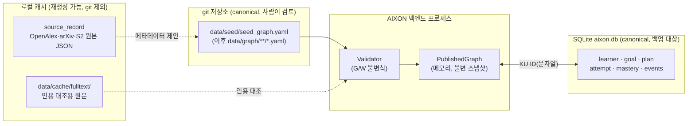
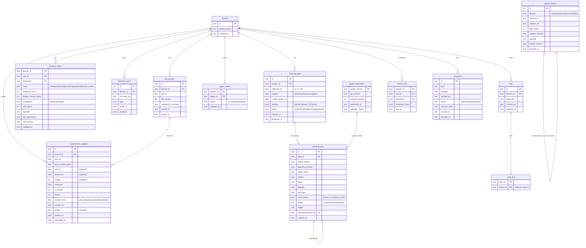
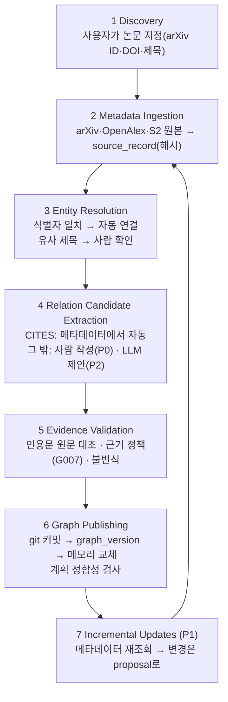

# 03. Data Model, Provenance & Ingestion

> 온톨로지([02](02_DOMAIN_ONTOLOGY.md))를 실제 저장 형식으로 옮긴 문서. 큐레이션 그래프의 **YAML 스키마**, 개인 학습 데이터의 **SQLite 스키마**, 외부 학술 데이터 **수집 파이프라인**을 정의한다.
> 작성 2026-10-15 · 상태: MVP 설계안 v1

> **범위 상태(2026-10-15 방향 수정)**: §2(YAML 스키마)·§3(빌드 시 그래프)·§5(데이터 소스·수집)·§8(seedtool)은 v0.1 정적 사이트에 그대로 쓴다. §4(개인 데이터 SQLite)는 **P2**다. Wiki 문서 스키마는 [CONTENT_SCHEMA.md](CONTENT_SCHEMA.md).

---

## 1. 저장 전략 한눈에 보기



| 데이터 | 정본(canonical) 위치 | 이유 |
|---|---|---|
| 큐레이션 지식 그래프(엔티티, Claim, Evidence, 문항, 목표, Lab 정의) | **git 안의 YAML** | 개정 이력, diff 리뷰, 되돌리기, 그래프 버전 관리를 git으로 해결한다. LLM이나 도구가 제안한 변경도 **사람이 diff로 검토**한 뒤 들어온다 |
| 공개된 그래프 읽기 모델 | 백엔드 **메모리** (YAML에서 매번 다시 만든다) | MVP 그래프는 수백 노드 규모다. DB 투영, 재귀 CTE, 그래프 DB가 모두 필요 없다 |
| 개인 학습 데이터(목표, 계획, 응답, 숙련도, 이벤트, 메모) | **SQLite 파일** | 단일 사용자, 로컬 우선, 백업은 파일 복사로 충분하다. Docker도 서버도 필요 없다 |
| 외부 원본 메타데이터·원문 | 로컬 캐시(SQLite `source_record` 테이블, `data/cache/`) | 변경 불가, 해시로 식별, 언제든 다시 가져올 수 있다 |

결정 근거와 재검토 조건은 [DECISIONS.md](DECISIONS.md)의 ADR-001·002·003에 있다. 요약하면 이렇다. 그래프가 **수만 Claim**을 넘어 시작 시간이 5초를 넘거나, **여러 사용자가 동시에 큐레이션**하게 되면 YAML → DB 정본 전환과 PostgreSQL을 검토한다.

---

## 2. 큐레이션 그래프 YAML 스키마 (schema_version 1)

### 2.1 파일 구조

최상위 키가 엔티티 타입을 정한다. 각 항목의 `id` 접두사는 섹션과 일치해야 한다(G002).

```yaml
schema_version: 1
graph:
  id: aixon-seed-cv-representation      # 그래프 묶음 ID
  name: "CV Representation Learning — CNN → Transformer → ViT"
  description: "..."
  assumed_background:                    # 그래프 밖 전제 지식(경로 설명에 표시)
    - "고등학교 대수, 지수·로그 함수"
  updated_at: 2026-10-15

fields:            [ResearchField ...]
problems:          [ResearchProblem ...]
concepts:          [Concept ...]
methods:           [Method ...]
models:            [Model ...]
papers:            [Paper ...]
datasets:          [Dataset ...]
metrics:           [Metric ...]
benchmarks:        [Benchmark ...]
objectives:        [LearningObjective ...]
resources:         [LearningResource ...]
assessment_items:  [AssessmentItem ...]
labs:              [LabExperiment ...]
sources:           [Source ...]
claims:            [Claim ...]
```

### 2.2 섹션별 필드

`✓` = 필수. 타입은 YAML 기준(`str`, `int`, `date`=YYYY-MM-DD, `list`, `map`).

**공통**(모든 엔티티 섹션): `id ✓`, `name ✓`(Paper는 `title ✓`), `aliases: list[str]`, `summary: str`, `summary_by: str`(AI가 쓴 요약이면 `agent:<model>`), `fields: list[field id]`, `related: list[{id, note ✓}]`, `status: active|deprecated|merged`, `merged_into: id`, `classification_note: str`.

| 섹션 | 추가 필드 |
|---|---|
| `fields` | `parents: list[field id]`, `external_ids: {openalex: str}` |
| `problems` | `summary ✓`, `question ✓` |
| `concepts` / `methods` / `models` | `summary ✓`, `dimensions ✓: list[recognize\|explain\|derive\|implement\|analyze]`(recognize·explain 필수 포함), `formula: str(LaTeX)`, `estimated_minutes: map[dimension → int]`, models만 `variants: list[str]` |
| `papers` | `authors ✓: list[str]`, `earliest_public_date ✓: date`, `venue: str`, `identifiers ✓: {doi, arxiv, arxiv_doi, openalex: list, s2, dblp, openreview}`(최소 하나), `metadata_checked: map[system → date]` |
| `datasets` | `summary ✓`, `size: str`, `access: public\|restricted\|private`, `introduced_by: paper id` |
| `metrics` | `summary ✓`, `direction ✓: higher_is_better\|lower_is_better`, `unit: str`(예 `%`) |
| `benchmarks` | `dataset ✓`, `metrics ✓: list`, `split ✓: str`, `task: str` |
| `objectives` | `targets ✓: list[{unit ✓, dimension ✓}]`, `context: id`, `description: str` |
| `resources` | `format ✓: text\|video\|interactive\|paper_section`, `url`(또는 `lab`) ✓, `author: str`, `license: str`, `estimated_minutes: int`, `verified_at ✓: date`, `explains ✓: list[{unit ✓, dimensions ✓: list, locator: str}]` |
| `assessment_items` | `assesses ✓: {unit ✓, dimension ✓}`, `kind ✓: mcq\|numeric\|short_text\|lab_prediction\|self_explanation`, `prompt ✓: str(Markdown+KaTeX)`, `choices: list[str]`, `answer ✓`(kind별 형식), `tolerance: float`(numeric ✓), `rubric: list[str]`(self_explanation ✓), `rationale ✓: str`, `hint: str`, `lab: lab id`(lab_prediction ✓), `scenario: map`(lab_prediction ✓), `source: {source, locator}`, `verified_by: computation\|source\|review` |
| `labs` | `component ✓: str`, `version ✓: int`, `parameters ✓: list[{name, min, max, step, default}]`, `demonstrates ✓: list[{unit, dimensions}]`, `items ✓: list[item id]`, `reference_impl: str` |
| `sources` | `kind ✓: paper_version\|metadata_record\|web_page\|book_section`, `paper`(paper_version ✓), `url ✓`, `fulltext_url`, `version`, `retrieved_at ✓: date`, `content_sha256` |
| `claims` | `predicate ✓`, `subject ✓`, `object ✓`, `qualifiers: map`, `status ✓`, `confidence ✓: high\|medium\|low`, `evidence: list[Evidence]`, `verification: {method, by, at}`, `review: {by, at, decision, note}\|null`, `note`, `supersedes`, `rejected_reason`(rejected ✓) |

**Evidence**: `source`(curator_rationale이면 생략), `locator: map`, `quote: str(≤300자)`, `type ✓`, `stance ✓: supports|contradicts|qualifies`, `rationale`, `values: map`.

**문항 가중치**는 `kind`에서 정해진다(mcq 1, numeric 2, short_text 2, lab_prediction 1, self_explanation 1). YAML에 따로 적지 않는다. 숙련도 규칙은 [04 §3](04_LEARNING_ENGINE.md)에 있다.

### 2.3 정규화와 그래프 버전

- 로더는 YAML을 읽은 뒤 섹션 순서를 고정하고, 각 목록을 `id`로 정렬하고, 키도 정렬해 **정규 JSON**을 만든다. `graph_version = sha256(정규 JSON)[:12]`. 그래서 주석이나 서식만 바꾸면 버전이 그대로이고, 내용을 바꾸면 버전이 바뀐다.
- Claim의 `content_hash = sha256(정규 JSON of {predicate, subject, object, qualifiers, status})[:12]`. 학습 계획 정합성 검사에 쓴다([04 §5.3](04_LEARNING_ENGINE.md)).
- 파일이 커지면 `data/graph/<section>/<id-slug>.yaml`로 나눈다. 로더는 디렉터리를 합쳐 같은 정규 JSON을 만들기만 하면 된다. 분할해도 그래프 버전은 변하지 않는다.

### 2.4 학습자 fixture 스키마 (도구·테스트용)

실제 학습자 데이터는 DB에 있다. 계획기·숙련도 규칙의 **기준 구현과 테스트**를 위해 같은 정보를 YAML로도 표현한다.

```yaml
learner: me
self_reports:   [{unit, dimension, familiarity: 0..4, at}]
attempts:       [{item, correct: bool, hinted: bool, at}]   # at = ISO8601
overrides:      [{unit, dimension, action: skip|unskip, at}]
```

---

## 3. 메모리 그래프 (PublishedGraph)

백엔드는 시작할 때와 publish할 때 YAML → 검증 → 불변 스냅샷을 만든다. 쿼리는 모두 메모리에서 한다.

| 인덱스 | 내용 | 사용처 |
|---|---|---|
| `entities[id]` | 엔티티 레코드(타입별 Pydantic 모델) | 상세 화면 |
| `claims_by_subject[id]`, `claims_by_object[id]` | 술어별 목록 | Trace, Detail |
| `prereq_in[(u,d)]` | `(u,d)`에 걸린 요구 그룹 목록(AND 그룹 + OR 그룹) | 계획기 |
| `items_by_target[(u,d)]`, `resources_by_target[(u,d)]`, `labs_by_unit[u]` | Editorial Link 역색인 | 계획기, Learn |
| `search_index` | name·aliases·summary 토큰과 trigram | 검색(§6) |
| `timeline[paper]` | earliest_public_date | Research Graph 시간축 |

**그래프 질의 전략**: 질의는 모두 깊이를 제한한 순회(focus 노드에서 depth 1~2)와 `(u,d)` 폐포 계산이다. 둘 다 O(V+E)다. 시드 규모(노드 약 150, 간선 약 200)에서는 마이크로초 단위다. 수천 Paper 규모에서도 밀리초 단위로 예상된다(추론, 측정은 Sprint 4에서). 재귀 CTE·그래프 DB·클로저 테이블은 **측정된 병목이 생길 때** 도입한다(ADR-002).

---

## 4. 개인 데이터 SQLite 스키마

### 4.1 ERD



### 4.2 테이블 설명과 제약

| 테이블 | 단계 | 정본/파생 | 핵심 제약·설명 |
|---|---|---|---|
| `learner` | P0 | 정본 | MVP에는 행이 하나(`me`)뿐이다. 그래도 모든 테이블에 `learner_id`를 둔다. 비용은 열 하나이고, 다중 사용자로 확장할 때 스키마 변경이 필요 없다 |
| `graph_publication` | P0 | 정본 | 앱이 처음 본 그래프 버전마다 한 행. publish할 때 계획 정합성 검사를 한 번만 돌리는 데 쓴다 |
| `learning_goal` | P0 | 정본 | `targets`는 생성 시점의 **사본**이다. 큐레이션 목표가 나중에 바뀌어도 사용자의 목표는 그대로 유지된다. `options`에는 계획 옵션과 OR 대안 고정(`prefer`)을 저장해, 재계획할 때마다 같은 선택이 유지되게 한다. CHECK(status IN …) |
| `learning_plan` | P0 | 파생(스냅샷) | 계획은 언제든 다시 계산할 수 있지만 **당시 무엇을 왜 추천했는지** 남기려고 저장한다. `used_claims`로 그래프 개정 영향을 판정한다. 목표당 `current`는 하나뿐(부분 UNIQUE 인덱스 `WHERE status='current'`) |
| `assessment_attempt` | P0 | **정본, 추가만 허용** | 숙련도 증거의 원천이다. 문항의 unit·dimension·weight를 **응답 시점 값으로 복사**해 두므로 나중에 문항을 고쳐도 이력이 바뀌지 않는다. UPDATE·DELETE를 하지 않는다(앱 규칙 + 트리거로 막음) |
| `mastery_state` | P0 | **파생 캐시** | `attempts + events`에서 규칙 함수로 다시 계산한다. `rule_version`이 바뀌면 전체를 다시 계산한다. 직접 수정하는 API는 없다 |
| `learning_event` | P0 | 정본, 추가만 허용 | self_report, override, resource_opened, resource_marked_done, lab_session_started/ended, goal·plan·paper 상태 변화. **숙련도에 영향을 주는 이벤트는 self_report(claimed 표시용)와 override뿐**이다 |
| `lab_session` | P0 | 정본 | 상호작용 **요약**(만져 본 파라미터 범위, 변경 횟수)만 저장한다. 증거가 아니다. 슬라이더를 움직일 때마다 저장하지 않는다 |
| `paper_status` | P0 | 정본(현재 상태) | 변화는 learning_event에도 기록한다 |
| `note`, `note_link` | P1 | 정본 | `target_id`는 엔티티나 Claim ID |
| `review_card` | P1 | 정본 | FSRS 상태(04 §6) |
| `proposal` | P1 | 정본 | 학습자 피드백("선수 개념이 빠진 것 같다"), 도구·LLM이 만든 Claim 후보, 메타데이터 변경 제안. **결정 이력**이 남는다 |
| `source_record` | P1 | 캐시(변경 불가) | UNIQUE(system, external_id, content_sha256). 같은 내용을 다시 받으면 아무 일도 하지 않는다 |

**그래프 ID 참조**: `unit_id`, `item_id`, `paper_id`, `objective_id`는 YAML 그래프의 ID 문자열이다. 그래프가 DB 밖에 있으므로 FK가 없다. 대신 ① 쓸 때 앱 계층에서 현재 그래프에 그 ID가 있는지 확인하고 ② publish할 때 사용자 데이터가 가리키는 ID가 사라졌거나 merged·deprecated가 되었는지 보고한다(tombstone은 survivor로 따라간다).

**SQLite 설정**: `PRAGMA journal_mode=WAL; foreign_keys=ON; busy_timeout=5000`. 쓰기 주체는 백엔드 프로세스 하나다.

### 4.3 이벤트·이력 모델

- **이벤트 소싱 라이트**: 정본은 추가만 허용되는 `assessment_attempt`와 `learning_event`다. `mastery_state`와 화면의 진행률은 그것을 투영한 결과다. 규칙을 바꾸면 다시 투영하면 되므로, 과거 데이터를 새 규칙으로 해석할 수 있다.
- 그 밖의 테이블(goal, plan, paper_status)은 현재 상태 테이블이고, 상태가 바뀔 때 learning_event를 함께 쓴다(같은 트랜잭션).
- 큐레이션 그래프의 이력은 git이 담당한다. DB는 그래프의 이력을 복제하지 않는다.

---

## 5. 데이터 소스와 수집(Ingestion) 아키텍처

### 5.1 데이터 소스 비교

| 소스 | 주는 것 | 접근·한도(2026-10-15 확인) | 라이선스·재배포 | AIXON에서의 역할 | 주의 |
|---|---|---|---|---|---|
| **arXiv** (API, HTML) | 정본 메타데이터, 버전 이력, HTML 전문(LaTeXML) | 키 없음, 3초에 1회·연결 1개 | 메타데이터 CC0, 전문은 논문별 라이선스(대개 비독점 배포) | **식별자·제목·날짜 검증**(`verify_identifiers.py`), **인용 원문 대조**(`seedtool quotes`), 참고문헌 정답 | OAI-PMH `<created>`는 최신 버전 날짜라 v1 날짜로 쓰면 안 됨 |
| **OpenAlex** | Works, Topics(4 domain → 26 field → 252 subfield → 4,516 topic), 인용 | 키 없이 일일 1,000 credit(단건 무료, list 1, search 10), 무료 키는 일일 $1 상당 | CC0, 스냅샷 제공 | 분야 매핑(참고용), 인용 후보 | 같은 논문이 여러 work로 나뉨(ResNet·ViT·BERT 등 2개, DeiT 3개), **Transformer·BERT preprint 레코드 메타데이터 오염**, 병합 ID는 404, Concepts는 동결 |
| **Semantic Scholar** | paperId(preprint+출판본 병합), externalIds(ArXiv·DOI·DBLP·MAG·CorpusId), 인용·인용 의도·영향 인용 | 키 없는 공용 풀이 혼잡(27회 중 14회 429), 키 발급 시 1 RPS | API 재배포 금지, Datasets ODC-BY | externalIds 교차 확인, 인용 후보 | 참고문헌 오연결(오탐 4/49), 연도 필드가 arXiv 날짜 |
| **Crossref** | 출판사 DOI 메타데이터 | 공개 풀 단건 5/s·목록 1/s | 메타데이터 사실 CC0, 초록은 별도 | 학회·저널 DOI 확인 | NeurIPS·ICLR·ICML은 DOI 없음 |
| **DBLP** | CS 학회명 정규화 | API는 봇 차단, XML 덤프(1.1GB, CC0)는 받을 수 있음 | CC0 | 학회명 정규화(P1, 덤프) | 스크립트 접근 불가 |
| **OpenReview** | ICLR 등 리뷰·버전 | API가 봇 차단 | — | 수동 참고 | — |
| **Papers with Code** | (종료, 2025-07) | Hugging Face로 리다이렉트, 덤프는 HF `pwc-archive`(CC BY-SA 4.0) | — | 사용 안 함 | 메서드 행의 70%가 스팸으로 보임(조사 B) |

**인용 관계 실측**(시드 14편, arXiv HTML 참고문헌에서 만든 정답 46쌍): S2는 46쌍 중 45쌍을 찾았지만 오탐 4건이 섞였고(정밀도 91.8%), OpenAlex는 오탐 0건에 38–39쌍을 찾았다. 둘을 합친 뒤 원문 참고문헌으로 확인하면 46쌍이 모두 맞다. 그래서 자동 CITES(P1)는 **두 소스의 합집합을 후보로 쓰고, arXiv HTML 참고문헌으로 확인된 것만 verified**로 둔다. 상세: [docs/research/D_data_sources.md](research/D_data_sources.md).

### 5.2 식별자 매핑

| 우선순위 | 식별자 | 역할 | 비고 |
|---|---|---|---|
| — | 내부 ID `paper:<slug>` | 정본 키, 불변 | 사람이 정한다 |
| 1 | arXiv ID (`2010.11929`) | AI 분야 논문의 가장 안정적인 키 | 버전 접미사(`v2`)는 Source에만 붙인다 |
| 2 | DOI (출판사) | 학회·저널 버전 | 없는 학회가 많다(NeurIPS 등) |
| 3 | arXiv DOI (`10.48550/arXiv.<id>`) | DOI 기반 API로 arXiv 버전을 조회할 때 | DataCite가 발급한다 |
| 4 | OpenAlex Work ID 목록 | 주제(Topics), 인용, 메타데이터 | 한 논문에 여러 Work가 있을 수 있어 **목록**으로 둔다 |
| 5 | Semantic Scholar paperId / CorpusId | 인용 의도·영향 인용 정보, externalIds 교차 확인 | |
| 6 | DBLP key, OpenReview id | 학회명 정규화, ICLR 등 | |

**해결 순서**: 사용자가 준 식별자 → arXiv API로 정본 메타데이터 → S2 `arXiv:<id>` 조회로 externalIds(DOI·DBLP·CorpusId) → OpenAlex를 DOI로 조회하고 제목 검색으로 다른 Work를 찾는다 → 결과를 **제안**으로 보여 주고 사람이 확정한다.

**Preprint · 학회 · 저널 버전**: 기본은 **하나의 Paper에 여러 Source**다(02 §4.6). `earliest_public_date`는 arXiv v1 날짜, `venue`는 동료 심사를 거친 게재처다. Evidence는 항상 특정 버전을 가리킨다. 제목이 다르거나 기여가 늘어난 확장판은 별도 Paper로 둔다.

**엔티티 해결(entity resolution) 규칙**:
1. 식별자가 정확히 일치하면 같은 Paper다(자동).
2. 정규화한 제목(소문자, 구두점 제거)과 연도 ±1, 제1저자 성이 같으면 **중복 의심**으로 보고 사람이 확인한다. 자동 병합은 **하지 않는다**.
3. 병합은 YAML에서 identifiers를 옮기고 tombstone을 남기는 편집이다(02 §3.2). 원본 레코드는 그대로 둔다.

### 5.3 파이프라인



| 단계 | MVP(P0) | P1 | P2 |
|---|---|---|---|
| 1 Discovery | 사용자가 직접 정한다 | AIXON 안에서 OpenAlex/S2 검색 | 관심 분야 기반 추천 |
| 2 Metadata | 시드는 에이전트가 원문으로 검증해 YAML로 작성 | `aixon ingest <id>` CLI → 원본 캐시 + YAML 조각 제안 | 일정 주기 갱신 |
| 3 Resolution | 식별자 일치만 사용 | 유사 제목 중복 의심 보고 | |
| 4 Candidates | 사람이 작성 | CITES 자동 생성(`data/graph/generated/cites.yaml`) | LLM이 인용문과 함께 후보 제안 → proposal |
| 5 Validation | `seedtool validate` + `seedtool quotes` | 앱 안 Curation 화면에서 같은 검사 | 추출기별 precision 측정 |
| 6 Publish | 앱 시작 시 로드 | 앱 안 "다시 불러오기" + 정합성 검사 | |
| 7 Updates | 없음 | 수동 실행 갱신 작업 | 예약 실행 |

### 5.4 핵심 설계 질문에 대한 답

| 질문 | 답 |
|---|---|
| 원본 메타데이터와 정규화 엔티티를 어떻게 분리하나 | 원본은 `source_record`(변경 불가, 해시)에, 정규화 엔티티는 YAML(사람이 확정)에 둔다. 정규화는 `parser_version`이 붙은 **순수 함수**라서 원본이 같으면 결과도 같다 |
| 잘못 병합한 논문을 어떻게 복구하나 | YAML 병합 커밋을 `git revert` 한다. tombstone 덕분에 사용자 DB 참조는 깨지지 않는다. 병합 뒤 추가된 Claim은 검증기의 W105가 목록으로 알려 준다 |
| 출처가 바뀌면 기존 Edge를 어떻게 갱신하나 | Source의 `content_sha256`이 바뀌면 그 Source를 쓰는 Evidence를 **다시 대조**한다. 해시가 다르면 W106(재검증 필요)을 띄우고, 인용이 원문에 없으면 오류로 보고한 뒤 사람이 locator나 버전을 고친다. 자동 생성 CITES는 다시 생성하고, git diff로 변화를 본다 |
| 제안된 관계의 승인·반려 이력은 | proposal 테이블에 결정과 메모를 남기고, YAML에서 rejected Claim을 tombstone으로 둔다. git 이력에도 남는다 |
| Idempotent ingestion은 어떻게 보장하나 | ① 원본은 (system, id, 내용 해시)가 같으면 저장하지 않는다 ② 정규화는 순수 함수다 ③ 자동 Claim ID는 결정적 해시다 ④ YAML 쓰기는 정렬·정규화된 형태로만 한다. 그래서 같은 입력으로 다시 돌리면 git diff가 비어야 한다. 이것을 테스트로 고정한다 |

---

## 6. 검색

- **MVP**: 메모리 색인에서 `name`·`aliases` 정확 일치 > 접두 일치 > trigram 부분 일치 > `summary` 토큰 순으로 고정 점수를 매긴다. 한국어 별칭도 trigram으로 찾을 수 있다. 엔티티 수백 개 규모에서는 선형 탐색으로도 충분하다.
- **확장(P1)**: 엔티티가 수천 개가 되거나 메모 본문 검색이 필요해지면 SQLite FTS5 `tokenize='trigram'` 가상 테이블을 쓴다. 로컬 SQLite 3.45.3에서 동작을 확인했다(2026-10-15).
- **벡터/하이브리드 검색**: 도입하지 않는다(ADR-007). 재검토 조건: "자연어 질문으로 찾기" 실패가 기록상 반복되고 엔티티가 5천 개를 넘을 때.

---

## 7. 마이그레이션 전략

| 대상 | 방식 |
|---|---|
| SQLite 스키마 | Alembic. SQLite의 ALTER 제약 때문에 `render_as_batch=True`로 만든다. 마이그레이션마다 왕복(upgrade → downgrade → upgrade) 테스트를 둔다 |
| 파생 테이블(mastery_state) | 마이그레이션 대신 **재계산**한다(`aixon recompute-mastery`) |
| YAML 스키마 | `schema_version`을 올리고, `tools/migrate_graph_v{N}.py`(순수 변환) 실행 → 검증기 통과 → 커밋. 로더는 현재 버전만 읽는다 |
| 문항 변경 | 문항 내용 해시가 바뀌어도 과거 응답은 응답 시점 사본(unit·dimension·weight)을 유지한다. 의미가 바뀌는 변경이면 새 문항 ID를 만든다 |

---

## 8. 검증 도구 계약 (`tools/seedtool.py`)

MVP 백엔드보다 먼저 만드는 **표준 라이브러리 + PyYAML** 도구다. 나중에 백엔드의 publish 검증 모듈과 계획기 테스트의 **기준 구현(oracle)**이 된다.

| 명령 | 입력 | 출력 | 종료 코드 |
|---|---|---|---|
| `validate <graph.yaml>` | 그래프 | G/W 목록, 통계, graph_version | G 오류가 있으면 1 |
| `quotes <graph.yaml> [--cache DIR] [--offline]` | 그래프 | evidence마다 인용문이 원문에 있는지(NFKC·공백·하이픈 줄바꿈 정규화 후 포함 여부) | 없는 인용이 있으면 1 |
| `plan <graph.yaml> --objective <lo:id> --learner <learner.yaml>` | 그래프, 학습자 fixture | 계획 JSON(04 §4.7 형식) | 0 |
| `mastery <graph.yaml> --learner <learner.yaml>` | 같음 | `(unit, dim)`별 상태 JSON(04 §3) | 0 |

테스트(`tools/test_seedtool.py`)는 02 §9.1의 T1~T18과 04 §8의 계획기 테스트를 포함한다.
