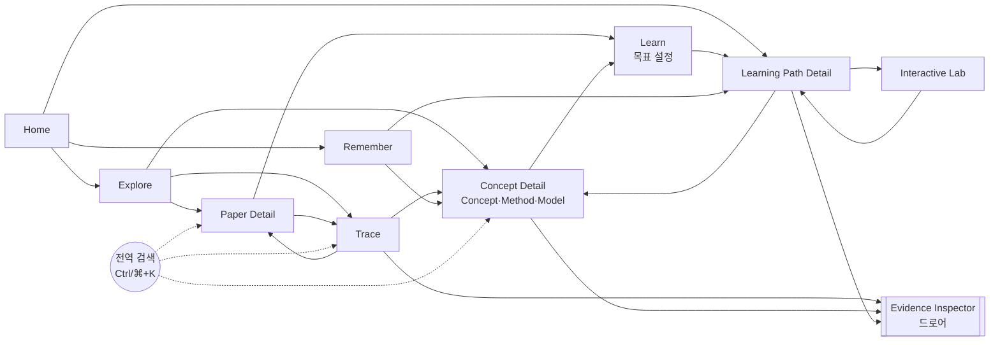
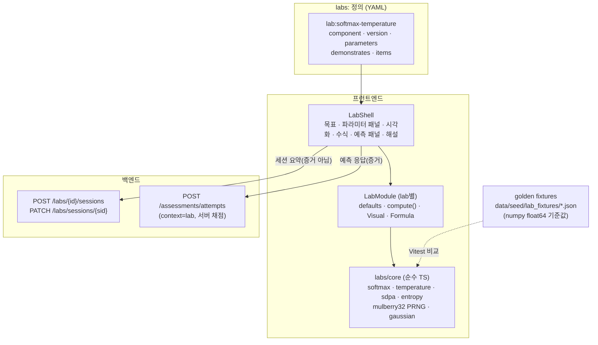

# 05. UX, Graph Visualization & Interactive Lab

> 화면 구조, 그래프 시각화, Interactive Lab 아키텍처. 화면에 필요한 데이터는 [03](03_DATA_MODEL.md), API는 [06 §5](06_SYSTEM_ARCHITECTURE.md#5-rest-api-계약), 경로 로직은 [04](04_LEARNING_ENGINE.md)에 있다.
> 작성 2026-10-15 · 상태: MVP 설계안 v1

> **범위 상태(2026-10-15 방향 수정)**: v0.1 화면 구성은 [WIKI_CONTENT_ARCHITECTURE.md §7](WIKI_CONTENT_ARCHITECTURE.md)이 대체한다. 이 문서의 원칙(U1–U6), 그래프 표기 규칙(§4.3), 접근성(§4.5), Lab 아키텍처(§5)는 그대로 유효하다. Learn·Path Detail·Remember 화면(§3.4, §3.5, §3.9)은 P2다. 선수 DAG 배치는 ELK.js 대신 dagre를 쓴다(ADR-020).

---

## 1. UX 원칙

| # | 원칙 | 적용 |
|---|---|---|
| U1 | **그래프는 수단이다** | 첫 화면에 거대한 지도를 보여 주지 않는다. 모든 그래프 화면은 **초점 노드 + 1단계 이웃**에서 시작하고, 같은 데이터를 **목록으로 보기**로도 제공한다 |
| U2 | **30초 안에 학습 시작** | 검색 → 상세 → "이것을 이해하고 싶다" → 첫 단계까지 클릭 3번 이하(성공 지표 S2, [00](00_PRODUCT_BRIEF.md)) |
| U3 | **신뢰 수준을 늘 보이게** | 모든 관계 간선과 문장에 검증 상태 배지를 단다. 색만으로 구분하지 않고 모양·아이콘도 함께 쓴다 |
| U4 | **증거로 한 번에 이동** | 간선이나 배지를 누르면 Evidence Inspector가 열린다. 원문 링크는 인용 위치로 바로 이동한다(URL text fragment `#:~:text=`) |
| U5 | **학습 행동과 평가를 분리해 보여 준다** | "읽음 표시"와 "확인 문제 통과"를 다른 모양으로 표시한다. 읽음 표시는 숙련도에 반영되지 않는다는 문구를 그 자리에 둔다 |
| U6 | **AI 생성 텍스트는 표시한다** | `summary_by: agent:*` 요약, (P2) LLM 설명에는 "AI 작성" 라벨을 붙인다 |

---

## 2. 정보 구조 (Information Architecture)



- 최상위 탭은 **Home · Explore · Trace · Learn · Remember · Lab** 여섯 개다. Detail 화면과 Evidence Inspector는 링크로 들어간다.
- **Evidence Inspector는 오른쪽 드로어**다. 어느 화면에서든 열 수 있고, 현재 화면 상태를 유지한다. 열린 Claim은 URL의 `?claim=` 파라미터에 남는다.
- 화면 상태(초점 노드, 필터, 깊이, 열린 Claim, 학습 단계)는 **URL에 담는다.** 그래서 새로고침이나 뒤로 가기를 해도 같은 화면으로 돌아오고, 북마크도 된다.

---

## 3. 화면 명세

각 화면의 Loading / Empty / Error 공통 규칙: 로딩은 레이아웃을 그대로 유지한 스켈레톤으로 보여 준다. 오류는 원인 한 줄과 "다시 시도"를 함께 보여 주며, 백엔드가 꺼져 있으면 `aixon serve`를 실행하라는 안내를 띄운다. 빈 상태는 다음에 할 수 있는 행동 하나를 제시한다.

### 3.1 Home / Dashboard

| 항목 | 내용 |
|---|---|
| 사용자 목표 | 하던 학습을 바로 이어 간다 |
| 표시 정보 | ① 진행 중인 목표마다 **다음 단계 카드**(단위, 차원, 예상 시간, 이유 한 줄)와 "계속하기" ② 최근 숙달한 것 ③ 확인 필요(자기보고만 있음, 복습 필요) ④ 읽기 목록(읽는 중, 읽을 예정) ⑤ 그래프 상태: 버전, "사람 검토 대기 Claim N개" |
| 핵심 상호작용 | 계속하기 → Learning Path Detail의 현재 단계 / 검색 / 추천 목표 시작 |
| 상태 변화 | 없음(탐색만 한다) |
| 연결 | Learning Path Detail, Remember, Explore, Curation(P1) |
| Empty | 첫 실행: "논문이나 개념을 검색해 시작하세요" + 시드 대표 목표 카드("ViT의 Attention 수식 이해하기") |
| 복잡도 관리 | 첫 화면 안에는 카드 3종까지만 둔다. 그래프는 두지 않는다 |

### 3.2 Explore

| 항목 | 내용 |
|---|---|
| 사용자 목표 | AI 연구 지형을 파악하고 다음에 볼 주제를 찾는다 |
| 표시 정보 | 왼쪽: 분야 트리(SUBFIELD_OF, 다중 부모는 두 곳에 모두 표시하고 "다른 위치" 표시). 오른쪽: 선택한 분야의 요약, 하위 분야, **주요 연구 문제**(ResearchProblem과 그것을 다룬 모델 수), 대표 모델·논문(연도순 미니 타임라인), 관련 분야(RELATED_TO note와 함께), **지금 배울 수 있는 것**(학습 경계) |
| 학습 경계(learning frontier) | 이 분야의 KU 가운데 아직 숙달하지 않았고, **모든 필수 선수(explain 기준)를 이미 숙달한** 것. Knowledge Space Theory의 *outer fringe*와 같은 개념이다. 이것을 "다음 학습 주제 추천"의 결정적 규칙으로 쓴다 |
| 핵심 상호작용 | 트리 펼치기·선택, 문제·모델·논문 열기, "검증된 것만 보기" 필터(기본 켜짐) |
| 상태 변화 | 없음 |
| 연결 | Paper/Concept Detail, Trace(문제나 모델에 초점) |
| Empty | 큐레이션되지 않은 분야: "아직 이 분야는 큐레이션되지 않았습니다" + (P1) OpenAlex Topic 링크 |
| 복잡도 관리 | 트리 + 목록만 쓴다. 분야 전체 지도(sunburst 등)는 P2에서 측정하고 판단한다 |

### 3.3 Trace (Research Graph)

| 항목 | 내용 |
|---|---|
| 사용자 목표 | 한 모델·논문을 중심으로 무엇이 무엇에서 나왔고 무엇을 개선했는지 본다 |
| 표시 정보 | **시간축 그래프**: x = 처음 공개된 연도(INTRODUCES 논문 날짜), y = 계보 레인(아래 §4.1). 노드는 Model·Method(논문 연도 배지), 문제 레인에는 ResearchProblem. 간선 종류는 §4.3 표 |
| 핵심 상호작용 | 노드 **펼치기**(이웃 1단계 추가) / 접기, 술어 필터 칩, CITES 표시 토글(기본 끔), 미검증 표시 토글(기본 끔), 연도 범위 지정, 간선 클릭 → Evidence Inspector, 노드 클릭 → 요약 팝오버 → Detail |
| 상태 변화 | URL: `focus, expand[], predicates, show_cites, show_unverified, years` |
| 연결 | Paper/Concept Detail, Evidence Inspector, Learn("이 모델 이해하기") |
| Empty | 연구 관계가 없는 노드: "검증된 연구 관계가 아직 없습니다" + 인용 관계 보기(CITES) 버튼 |
| Error | 레이아웃 실패 시 목록 보기로 대신 보여 준다 |
| 복잡도 관리 | 기본으로 초점 + depth 1, 보이는 노드 최대 60개(넘으면 "+N개 더" 묶음 노드). 같은 쌍 사이 간선이 여럿이면 하나로 합치고 배지에 개수를 표시. **목록으로 보기**: (subject, 술어, object, 조건, 근거 수, 상태) 표 |

### 3.4 Learn (목표 설정)

| 항목 | 내용 |
|---|---|
| 사용자 목표 | "무엇을 할 수 있게 되고 싶은지" 정하고 경로를 받는다 |
| 표시 정보 | ① 문맥 엔티티(예: ViT 논문)의 **큐레이션 목표** 목록과 각 목표의 target·예상 시간 ② 사용자 정의 목표: 단위 선택 + 차원 선택("알아보기 · 설명하기 · 유도하기 · 구현하기 · 분석하기", 차원마다 한 줄 설명과 예시 문항) ③ **계획 미리보기**: 단계 수, 예상 시간, 생략할 것(이유와 함께), 진단할 것 ④ 선수 DAG(§4.2) 토글 |
| 핵심 상호작용 | 목표 고르기 → 미리보기 → "이미 아는 것 표시"(폐포 안 노드에 자기보고. 표시한 것은 진단 문항으로 바뀐다는 안내) → "시작" |
| 상태 변화 | `POST /api/goals` → learning_goal + 첫 learning_plan |
| 연결 | Learning Path Detail |
| Empty | 문맥이 없으면 시드 목표와 검색창을 보여 준다 |
| 복잡도 관리 | 미리보기는 숫자 요약과 목록이 기본이고 DAG는 선택해서 연다 |

### 3.5 Learning Path Detail

| 항목 | 내용 |
|---|---|
| 사용자 목표 | 계획을 한 단계씩 따라간다 |
| 표시 정보 | 단계 목록(행동 배지 진단·학습·복습, 단위, 차원, 예상 시간, **왜 필요한가** 펼침 사슬), 현재 단계 패널(자료 링크, Lab 링크, 확인 문항), 생략 목록(증거 요약), 대체 경로(OR 선택), 경고, 계획 버전과 **바뀐 점 배너** |
| 핵심 상호작용 | 자료 열기(이벤트 기록) · 읽음 표시(숙련도에 반영되지 않는다는 문구 옆에 표시) · 문항 풀기 → 즉시 채점과 해설 → **숙련도 변화 토스트**("softmax · 설명: 연습 중 → 숙달") → 재계획 결과(바뀐 점) · 단계 생략(확인 대화상자: "숙련으로 기록되지 않습니다") · OR 대안 고정 |
| 상태 변화 | attempts → mastery_state → learning_plan(새 버전) |
| 연결 | Concept Detail, Lab, Evidence Inspector(why 사슬의 Claim) |
| Error | 제출이 실패하면 응답을 로컬에 보관하고 다시 시도한다 |
| 복잡도 관리 | 한 번에 현재 단계 하나만 펼친다. 완료한 단계는 접는다 |

### 3.6 Concept Detail (Concept · Method · Model 공통)

| 항목 | 내용 |
|---|---|
| 사용자 목표 | 이 단위가 무엇이고 무엇으로 이루어졌으며 무엇이 필요한지, 나는 얼마나 아는지 안다 |
| 표시 정보 | 헤더(타입 배지, 이름, 별칭, 요약 + AI 라벨, 수식 KaTeX) · **내 숙련도**(단계 + 차원별 칩, 칩을 누르면 증거) · **선수 지식(차원 탭: "설명하려면 / 유도하려면 / 분석하려면")** · 이것을 필요로 하는 것 · 구성(PART_OF, IS_A) · 연구 기원(INTRODUCES 논문, Model이면 EXTENDS·ADAPTS 요약) · 학습 자료(차원별) · Lab · 연습 문항 · 관련 항목(note 포함) · (P1) 메모 |
| 핵심 상호작용 | "이것을 목표로" + 차원 선택 · 자기보고(0~4) · 연습/진단 · 근거 보기 |
| 상태 변화 | 자기보고 → event → claimed 표시 |
| 연결 | Learn, Trace(Model), Lab, Evidence Inspector |
| 복잡도 관리 | 기본은 섹션 목록이다. 지역 선수 그래프(depth 1)는 접어 둔다 |

### 3.7 Paper Detail

| 항목 | 내용 |
|---|---|
| 사용자 목표 | 논문의 기여와 맥락을 파악하고, 읽기 위해 무엇을 배워야 하는지 안다 |
| 표시 정보 | 서지(제목, 저자, 최초 공개일, 게재처, 식별자 외부 링크 arXiv/DOI/OpenAlex/S2) · 버전(Source 목록) · 요약(AI 라벨) · **INTRODUCES**(이 논문이 제시한 것) · **ADDRESSES**(다룬 문제) · 이 논문이 근거인 Claim 목록 · **결과 표**(IMPROVES_ON·EVALUATED_ON의 수치와 조건) · 아틀라스 안의 인용/피인용 · 읽기 상태 · **"이 논문을 읽기 위한 목표"**와 "아직 모르는 선수 N개" 미리보기 |
| 핵심 상호작용 | 읽기 상태 설정 · 목표 시작 · Trace로 보기 · 근거 보기 |
| 상태 변화 | paper_status, event |
| 연결 | Trace, Learn, Concept Detail, Evidence Inspector |
| Empty | 큐레이션된 Claim이 없는 논문: 서지 정보와 "아직 분석되지 않은 논문" 표시 |

### 3.8 Evidence Inspector (드로어)

| 항목 | 내용 |
|---|---|
| 사용자 목표 | 관계가 **왜** 있는지 확인하고 얼마나 믿을지 정한다 |
| 표시 정보 | Claim을 자연어 문장으로("ViT는 Transformer를 NLP에서 CV로 **적용(ADAPTS)**했다") · 술어 정의와 판별 질문 · 상태 배지(verified/proposed/disputed/rejected/deprecated) · 검증 정보(방법, 주체, 날짜) · **사람 검토 여부** · confidence(서열과 의미 설명) · 근거 목록: 인용문(강조), 위치(§, 표, 쪽), Source 버전, stance · disputed이면 **지지/반대 근거를 나란히** · 이력(supersedes 사슬) · 이 Claim을 쓰는 내 학습 경로 |
| 핵심 상호작용 | "원문에서 보기"(text fragment로 인용 위치를 연다) · 인용 복사 · (P1) 검토: 승인/반려/이의 + 메모 |
| 상태 변화 | (P1) proposal 결정 → YAML 갱신 → 재publish |
| 복잡도 관리 | Claim 하나씩 보여 준다. 여러 Claim은 목록 → 상세로 연다 |

### 3.9 Remember

| 항목 | 내용 |
|---|---|
| 사용자 목표 | 무엇을 알고, 무엇이 흔들리고, 무엇을 공부했는지 본다 |
| 표시 정보 | 분야별 숙련 현황(단위 × 단계 표) · **확인되지 않은 자기보고** 목록(진단 권유) · 복습 필요 목록 · (P1) 복습 예정 큐 · 학습 이력 타임라인(응답, 목표, 계획 변경) · 읽기 목록 · (P1) 메모 |
| 핵심 상호작용 | 진단·복습 시작 · 분야/차원 필터 · 데이터 내보내기(JSON) |
| 복잡도 관리 | 표와 목록 중심. 차트는 차원별 숙달 수 막대 하나만 둔다. 게임화 요소(연속 기록 등)는 넣지 않는다 |

### 3.10 Interactive Lab

§5에서 자세히 다룬다. 화면 공통 틀은 **목표 → 예측 → 관찰 → 설명 → 자유 탐색**이다.

---

## 4. 그래프 시각화

### 4.1 Research Graph (Trace): 시간축 레이아웃

- **x축 = 연도**: `x = (year − minYear) · pxPerYear`. 같은 해 노드는 월 단위로 조금 띄운다. D3 없이 한 줄로 계산한다.
- **y축 = 계보 레인**: 레인은 초점 노드의 분야(IN_FIELD)와 간선 연결 성분으로 정한다. 시드 기준 레인은 CNN 레인(AlexNet → VGG → ResNet → BiT), Attention/NLP 레인(Bahdanau → Transformer → BERT), Vision Transformer 레인(ViT → DeiT, Swin), 그리고 문제 레인(맨 아래, ResearchProblem)이다. 레인 안에서는 날짜순으로 놓고, 겹치면 아래로 민다. **ELK를 쓰지 않는 결정적 계산**이라서 같은 입력이면 같은 그림이 나온다.
- **연구 그래프 전체를 DAG로 가정하지 않는다**: COMPARED_WITH와 동시 연구(`concurrent: true`)는 같은 x 근처의 수직 간선으로 그린다. 시간을 거스르는 간선(G014 예외)은 점선과 경고로 표시한다.

### 4.2 Prerequisite DAG (Learn, Path Detail)

- **dagre 계층형 배치**(ADR-020), 방향 위→아래(기초가 위, 목표가 아래). 노드는 KU 하나에 필요한 차원 칩이 붙은 형태다(`softmax [설명]`, `SDPA [설명 · 유도]`). `(u,d)` 노드를 단위별로 묶어 그림이 복잡해지지 않게 한다.
- 간선 라벨은 차원 조건이다("유도하려면"). OR 그룹은 작은 마름모 노드(⋁)로 묶는다.
- 노드 상태 색과 모양: 생략(회색 + ✓), 진단(노랑 + ?), 학습(파랑), 현재(굵은 테두리), 숙달(초록 + ★). 색맹을 고려해 아이콘을 항상 함께 쓴다.
- 레이아웃 결과는 `(graph_version, 뷰)` 키로 캐시한다(dagre는 수십 노드에서 충분히 빠르므로 Web Worker를 쓰지 않는다).

### 4.3 간선·배지 표기 규칙

| 술어 | 선 | 화살표 | 라벨 |
|---|---|---|---|
| EXTENDS | 실선 | ▶ | — |
| ADAPTS | 실선 + 중간 ⇄ 마커 | ▶ | "NLP→CV" |
| IMPROVES_ON | 굵은 실선 | ▶ | 지표·수치("ImageNet top-1 88.55 vs 87.54, JFT 사전학습") |
| COMPARED_WITH | 파선 | 없음 | 벤치마크 |
| ADDRESSES | 점선(문제 레인으로) | ▶ | — |
| MITIGATES | 실선(문제 레인으로) | ▶ | 근거 종류 아이콘 |
| CITES | 얇은 회색(기본 숨김) | ▶ | — |
| PREREQUISITE_OF | 실선 | ▶ | 차원 조건 |
| RECOMMENDED_BEFORE | 파선 | ▷ | "권장" |

| 검증 상태 | 표시 |
|---|---|
| verified + 사람 검토 | 기본 선 |
| verified (에이전트 검증, 사람 검토 대기) | 기본 선 + 작은 빈 원 배지 |
| proposed | 점선 + "미검증" 배지(기본 숨김) |
| disputed | 경고 삼각형 + 지그재그 끝 표시 |
| rejected / deprecated | 표시하지 않음(Evidence Inspector 이력에서만 보임) |

### 4.4 라이브러리 비교와 선택

| 라이브러리 | 렌더링 | 배치 | 접근성 | 크기·라이선스(npm, 2026-10-15) | 판단 |
|---|---|---|---|---|---|
| **React Flow** (`@xyflow/react` 12.12) | DOM(노드 = React 컴포넌트) | 내장 없음(dagre·ELK와 결합) | 문서화된 키보드·ARIA 지원. 기본값은 모든 노드·간선이 Tab 정지점이라 간선 포커스를 꺼야 한다 | MIT. 공식 스트레스 예제 450노드 | **채택**(Atlas·Trace·지역 그래프) |
| **dagre** (`@dagrejs/dagre` 3.1) | — | 계층형 배치 | — | TS로 재작성, 약 17KB gzip, MIT | **채택**(ADR-020) |
| ELK.js 0.12 | — | layered 등 고급 배치, Web Worker | — | 약 467KB gzip, EPL-2.0 OR GPL-3.0(수정 없이 배포 시 출처 고지만 필요) | 보류 |
| Cytoscape.js 3.34 | Canvas(WebGL은 3.31부터 미리보기) | 다수 내장 | 앱 수준에서 구현해야 함 | MIT | 대규모 지도 필요 시 |
| Sigma.js 4.0 + graphology | WebGL2 | 별도 | 제한적 | MIT, React 바인딩은 v3만 | 수천 노드 전체 지도(P2) |
| D3 7.9 | SVG | 직접 | 직접 | ISC | 쓰지 않음(시간축은 한 줄 계산) |
| KaTeX 0.19 / MathJax 4 | 빌드 시 HTML+MathML / 런타임 | — | MathJax 4는 한국어 음성 지원, KaTeX의 숨은 MathML 방식은 덜 안정적이라고 평가 | 둘 다 MIT·Apache | **KaTeX 빌드 시 렌더링**(클라이언트 비용 0, MathML 포함). 접근성 불만이 기록되면 MathJax 재검토 |

상세와 출처: [docs/research/G_viz_tech.md](research/G_viz_tech.md).

### 4.5 성능·검색·접근성

- **성능**: 보이는 노드를 상한(Trace 60, DAG 80) 안에 두고, React Flow 노드 컴포넌트는 `memo`로 감싼다. 뷰포트 밖 요소는 렌더링하지 않는 옵션을 켠다. 레이아웃 결과는 캐시한다. 목표는 시드 규모에서 첫 그림 200ms 이하다(Sprint 3에서 측정).
- **검색**: 전역 검색(Ctrl/⌘+K). 결과를 타입별로 묶고 타입 배지를 붙이며 키보드로만 조작할 수 있다. 그래프 화면 안 검색은 노드를 강조하고 그 노드로 이동한다.
- **접근성**: 모든 그래프에는 같은 내용을 담은 **목록/표 보기**가 있다(스크린 리더의 기본 경로). 노드는 Tab으로 이동할 수 있고 `aria-label`에 "타입, 이름, 연도, 상태"를 담는다. 상태는 색과 모양·아이콘으로 함께 표시한다. `prefers-reduced-motion`을 따른다. 수식은 KaTeX의 MathML 출력을 함께 둔다.

---

## 5. Interactive Lab 아키텍처

### 5.1 원칙

1. **실험(Lab session)과 평가(Attempt)를 분리한다.** 세션은 탐색 기록이고 증거가 아니다. 예측 문항(`lab_prediction`) 응답만 증거다.
2. **계산은 브라우저에서**, 결정적으로 한다(ADR-007). 서버는 정의를 내려 주고 응답을 채점·저장한다.
3. **예측 → 관찰 → 설명**(Predict–Observe–Explain): 학습자는 결과를 보기 **전에** 예측하고 제출한다. 그다음 시뮬레이션이 같은 시나리오를 보여 주고, 해설이 수식과 연결해 준다.
4. **수식과 그림을 같은 값으로 묶는다**: 슬라이더 값이 수식 안의 기호 자리에 실시간으로 들어간다.

### 5.2 구성요소



```ts
// labs/types.ts — Lab 모듈 계약
export interface LabModule<P, R> {
  id: string;                 // "lab:softmax-temperature"
  version: number;            // YAML labs[].version 과 일치해야 로드
  defaults: P;
  compute(params: P): R;      // 순수·결정적. 난수는 params.seed 로만
  Visual: React.FC<{ params: P; result: R; onChange(p: Partial<P>): void }>;
  Formula: React.FC<{ params: P; result: R }>;   // KaTeX, 실시간 값 대입
}
```

- `lab_prediction` 문항의 `scenario`(고정 파라미터)는 YAML에 있다. 예측 패널은 시나리오대로 파라미터를 **잠근 채** 묻는다. 제출하면 잠금을 풀고 시나리오 결과를 보여 준다.
- 정답 키는 서버에만 있다(06 §9). MVP 문항은 모두 **정적 시나리오**라서 정답을 미리 계산해 YAML에 둘 수 있다. 무작위로 생성하는 문항은 P1에서 서버 측 Python 기준 구현으로 채점한다.

### 5.3 첫 Lab: Softmax Temperature & Scaled Dot-Product Attention

**목표**(DEMONSTRATES): `concept:softmax@explain`, `concept:softmax-temperature@explain`, `concept:variance-of-sum@explain`, `method:scaled-dot-product-attention@derive`.

**모드 A — Temperature**
- 입력: logit 5개(막대를 끌어서 수정), 온도 `T ∈ [0.05, 5]`(로그 스케일 슬라이더).
- 출력: `softmax(z/T)` 확률 막대, 최대 확률, 엔트로피(nats), 수식 `p_i = e^{z_i/T} / Σ_j e^{z_j/T}`에 현재 값 대입.
- 관찰 포인트: T → 0이면 argmax 원-핫에 가까워지고, T → ∞이면 균등분포에 가까워진다. logit에 상수를 더해도 결과가 같다(shift invariance).

**모드 B — Scaled Dot-Product**
- 입력: `d_k ∈ {1, 4, 16, 64, 256, 512, 1024}`(아래 표와 E2E-2가 512를 쓴다), 키 개수 n = 8, scaling on/off, seed.
- 계산: `q, k_j ~ N(0, I_{d_k})`(seed 고정) → logits `q·k_j`(scaling을 켜면 `/√d_k`) → attention 가중치.
- 통계 패널(seed 고정 1,000 표본): 경험적 `Var(q·k)` 대 `d_k`(로그-로그 기울기 1), 평균 최대 가중치(포화 정도), softmax Jacobian 노름(기울기 크기) — scaling 유무에 따라.
- 수식 연결: Transformer 논문 §3.2.1과 각주 4. "성분이 평균 0, 분산 1인 독립 확률변수라면 `q·k = Σ q_i k_i`는 평균 0, 분산 `d_k`"(Evidence 인용과 같은 문장을 보여 주고 Evidence Inspector로 링크한다).

**예측 문항**(시드 `assessment_items`의 `lab_prediction`):

| 문항 | 시나리오 | 묻는 것 | 정답(계산 확인) |
|---|---|---|---|
| `ai:lab-softmax-temp-01` | z = [2, 1, 0], T를 1 → 0.1 | 최대 확률은? (커짐/작아짐/그대로) | 커짐(0.665 → 0.99995) |
| `ai:lab-softmax-temp-02` | z = [2, 0], T = 2 | p₁ 값 | 0.731 ± 0.005 |
| `ai:lab-sdpa-01` | scaling off, d_k 4 → 512, n = 8 | 평균 최대 가중치는? | 1에 가까워짐(포화): 0.525 → 0.955 |
| `ai:lab-sdpa-02` | d_k = 64, 성분 i.i.d. N(0,1) | q·k의 표준편차 | 8 ± 0.5 |

정답 수치는 `tools/gen_lab_fixtures.py`(numpy float64)로 계산했고, 같은 값이 `data/seed/lab_fixtures/softmax_temperature.json`에 들어 있다. 계산 결과(seed 42, 키 8개, 표본 1,000)는 Transformer 논문의 주장과 같은 경향을 보인다(2026-10-15 실행).

| d_k | scaling | 평균 최대 가중치 | softmax Jacobian Frobenius 노름(기울기 크기) |
|---|---|---|---|
| 4 | off | 0.525 | 0.341 |
| 64 | off | 0.872 | 0.153 |
| 512 | off | 0.955 | 0.063 |
| 4 / 64 / 512 | on (÷√d_k) | 0.341 / 0.361 / 0.365 | 0.360 / 0.365 / 0.366 |

scaling 없이 d_k가 커지면 분포가 포화하고 기울기가 작아진다("pushing the softmax function into regions where it has extremely small gradients"). √d_k로 나누면 두 값이 거의 일정하게 유지된다. 분산 확인(L6): d_k = 64, 표본 10,000에서 경험적 Var(q·k) = 64.65(+1.0%). PRNG 포팅은 Node의 mulberry32와 비트 단위로 같다는 것을 확인했다.

### 5.4 수치 정확성·재현성 테스트

| # | 테스트 | 기준 |
|---|---|---|
| L1 | softmax 합 = 1 | 모든 fixture에서 \|Σp − 1\| < 1e-12 |
| L2 | shift invariance | `softmax(z + c) == softmax(z)` (c = ±1000), 오차 < 1e-12 |
| L3 | 수치 안정성 | z = [1000, 0], [−1000, 0], T = 0.05에서 NaN·Inf 없음(max 빼기 구현) |
| L4 | golden 비교 | TS 결과 == numpy 기준값, 원소 오차 < 1e-12 |
| L5 | PRNG 재현성 | mulberry32(seed=42)의 첫 5개 값이 fixture와 정확히 일치 |
| L6 | 분산 성질 | seed 42, 표본 10,000, d_k = 64: 경험적 Var(q·k)이 64 ± 5% |
| L7 | 예측 문항 정답 | 각 `lab_prediction` 시나리오를 compute()로 돌린 결과가 YAML 정답과 일치 |

### 5.5 확장 Lab 후보 (P1~P2)

| Lab | DEMONSTRATES | 계산 | 비고 |
|---|---|---|---|
| Convolution & Receptive Field | convolutional-layer, receptive-field | 2D 격자 합성곱, 층을 쌓을 때 RF 계산(VGG 3×3 스택 = 7×7) | 시드 개념 재사용 |
| Gradient Descent | gradient-descent, learning rate | 2D 손실 곡면 등고선, 경로 | |
| Camera Projection | pinhole, intrinsics | 3D → 2D 투영 | 3D Perception 확장(P1)의 첫 Lab. three.js 도입 여부를 그때 결정 |
| Epipolar Geometry | fundamental matrix | 두 시점 대응점 | |
| Forward/Inverse Kinematics | 2-link arm | 해석적 IK | |
| Bellman / Q-Learning | value iteration | 격자 세계 | |
