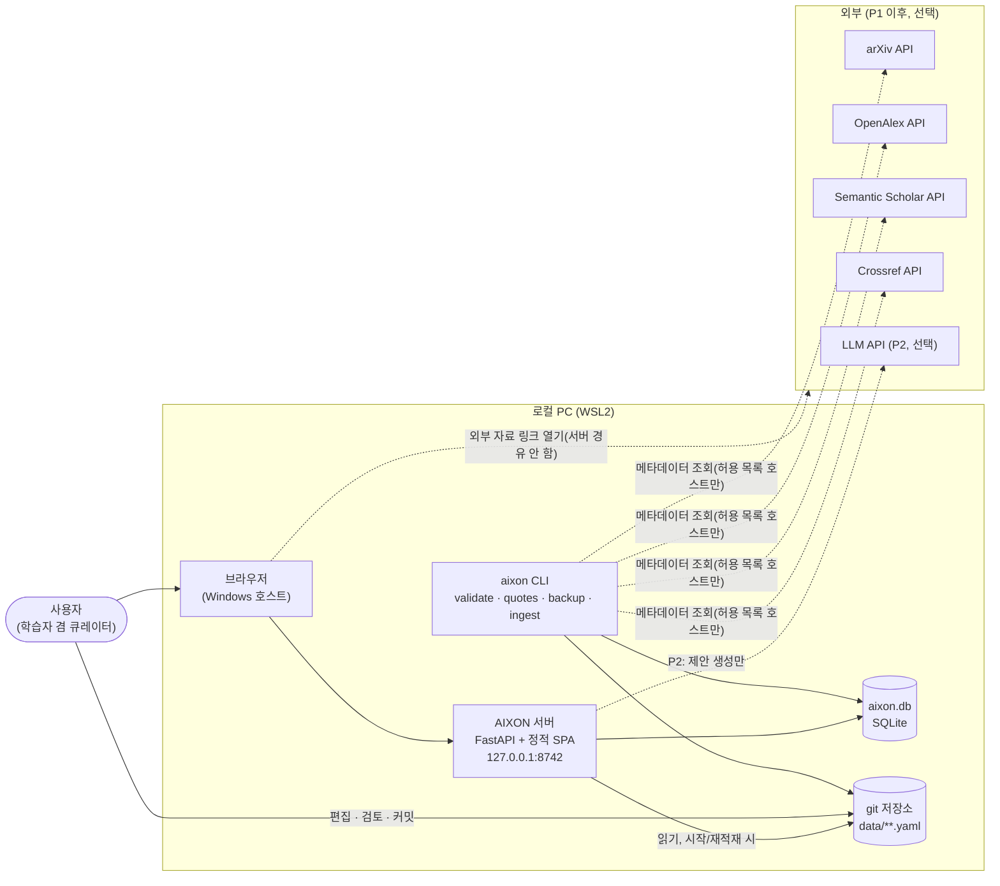
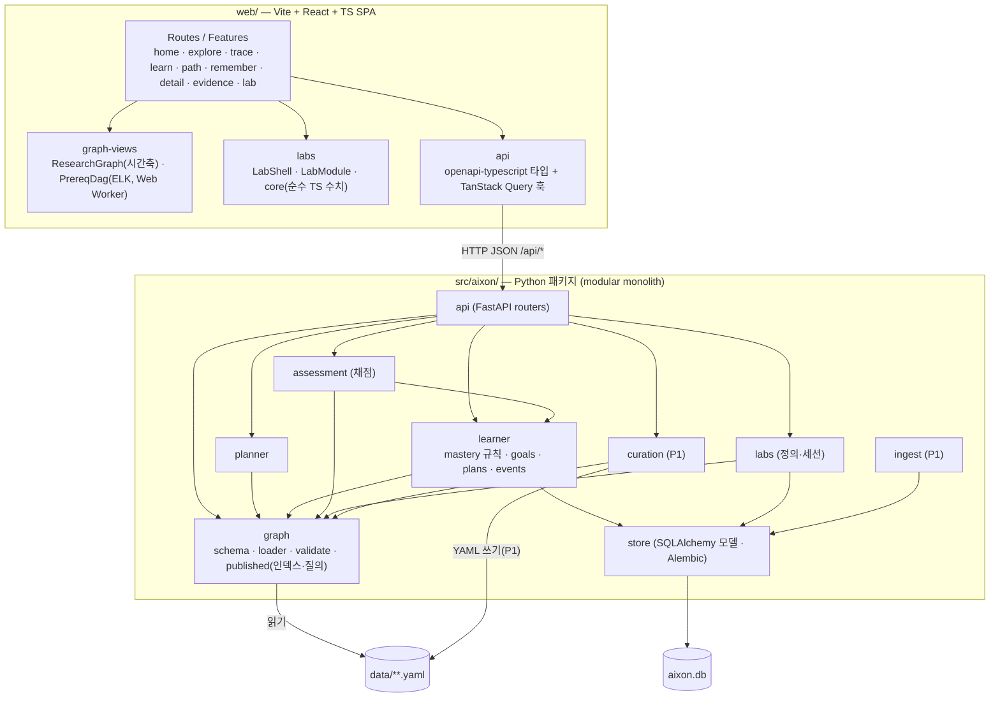
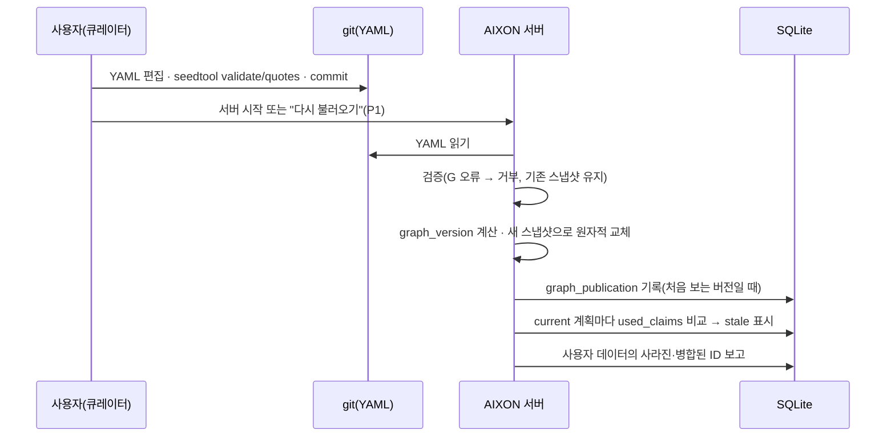
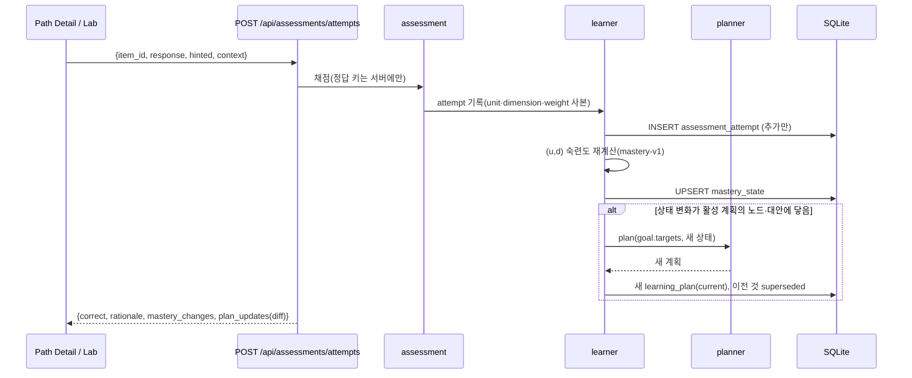
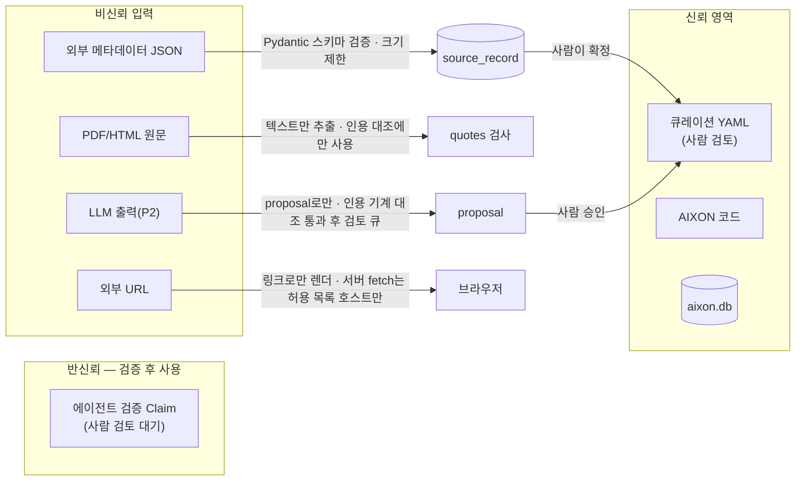

# 06. System Architecture

> 기술 구성, 모듈 경계, API 계약, 데이터 흐름, 보안·운영. 각 선택의 근거와 대안은 [DECISIONS.md](DECISIONS.md)에 있다.
> 작성 2026-10-15 · 상태: MVP 설계안 v1

---

## 1. 제약과 품질 속성

| 제약 | 설계 영향 |
|---|---|
| 개인 개발, 1인 유지보수 | 언어는 2개(Python 백엔드, TypeScript 프런트), 프로세스 1개, 서비스 0개 |
| WSL2, 로컬 우선, 단일 사용자 | `127.0.0.1`에만 바인딩, 인증 없음, SQLite 파일 하나. 데이터는 **WSL ext4 안**에 둔다. `/mnt/c`에 두면 SQLite 잠금과 성능 문제가 생긴다 |
| 운영 비용 최소, GPU 의존 최소 | 외부 유료 API 없음. Lab 계산은 브라우저 CPU에서 한다 |
| 다중 사용자 확장 가능성 | 모든 개인 테이블에 `learner_id`, SQLAlchemy로 DB 이식성 확보, 인증은 미들웨어 한 곳에서 붙일 수 있는 구조 |
| 검증된 작은 그래프 | 그래프는 메모리에서 처리, 그래프 DB 없음 |

품질 속성 우선순위: **정확성(결정성·근거 추적) > 유지보수성 > 학습 흐름 속도 > 확장성**.

현재 개발 환경(2026-10-15 확인): Node 22.23.2, pnpm, Python 3.12.7(anaconda), SQLite 3.45.3(FTS5 trigram 사용 가능). Docker·PostgreSQL·uv는 설치되어 있지 않다. 이 설계는 Docker와 PostgreSQL이 **필요하지 않다**.

---

## 2. System Context



- 외부 서비스는 **CLI와 백엔드만** 호출한다. 브라우저는 외부 자료를 새 탭 링크로만 연다. API 키는 브라우저에 절대 가지 않는다.
- MVP(P0)는 외부 호출이 **전혀 없어도** 동작한다. 시드는 이미 검증되어 YAML에 들어 있다.

---

## 3. Container / Component



### 3.1 모듈 의존 규칙

| 모듈 | 책임 | 의존해도 되는 것 | 금지 |
|---|---|---|---|
| `graph` | YAML 스키마(Pydantic), 로드, 불변식 검증, 불변 스냅샷, 질의(이웃·폐포·검색) | 표준 라이브러리, PyYAML, Pydantic | DB, 학습자 데이터 |
| `planner` | 04 §4 알고리즘 | `graph`, 학습자 상태 **인터페이스**(노드 → 분류) | DB 직접 접근, 시계(현재 시각은 인자로 받음) |
| `learner` | 숙련도 규칙(순수 함수), 목표·계획·이벤트 영속화, 재계획 트리거 | `graph`, `planner`, `store` | |
| `assessment` | 문항 채점(kind별), 정답 비공개 보장 | `graph`, `learner` | |
| `labs` | Lab 정의 제공, 세션 기록 | `graph`, `store` | 숙련도 변경 |
| `ingest` (P1) | 외부 API 클라이언트, `source_record` 캐시, YAML 조각·proposal 생성 | `store` | **큐레이션 YAML 직접 수정** |
| `curation` (P1) | 검토 결정 → YAML 갱신 → 재publish | `graph` | 검증 없이 쓰기 |
| `api` | HTTP 계층, 오류 변환, 직렬화 | 모두 | 비즈니스 규칙 구현 |

`graph`, `planner`, `learner.mastery`는 **순수 함수 중심**이라 DB 없이 테스트할 수 있다. 이 모듈들의 기준 구현은 `tools/seedtool.py`이고, 백엔드 테스트는 seedtool과 같은 fixture로 같은 출력을 내는지 확인한다.

### 3.2 저장소 디렉터리 구조 (구현 시)

```text
aixon/
  README.md  pyproject.toml  uv.lock  .gitignore  .env.example
  docs/                      # 이 설계 문서들
  data/
    seed/                    # seed_graph.yaml, learner_e2e.yaml, expected_plan_e2e.json, lab_fixtures/
    graph/                   # (P1) 분할된 큐레이션 그래프, generated/cites.yaml
    cache/                   # (git 제외) fulltext, 원본 레코드
  src/aixon/                 # graph/ planner/ learner/ assessment/ labs/ ingest/ curation/ store/ api/ cli.py settings.py
  migrations/                # Alembic (render_as_batch)
  tests/                     # unit/ api/ e2e/ (seedtool fixture 재사용)
  tools/                     # seedtool.py, test_seedtool.py, gen_lab_fixtures.py
  web/                       # package.json, vite.config.ts, src/{app,api,features,graph-views,labs}, tests/, e2e/
```

---

## 4. 주요 데이터 흐름

### 4.1 그래프 publish



### 4.2 평가 → 숙련도 → 재계획 (E2E 6~8단계)



### 4.3 Trace 질의

`GET /api/graph/research?focus=model:vit&depth=1` → `graph.published`가 초점 노드의 Research 술어 이웃을 모으고(verified만, 옵션에 따라 CITES와 미검증 포함) → 노드마다 INTRODUCES 논문 날짜로 `year`를 붙이고 계보 레인 힌트(소속 분야)를 붙여 반환 → 프런트가 시간축 배치를 계산한다(05 §4.1). 응답에는 `graph_version`과 ETag가 붙는다.

---

## 5. REST API 계약

공통 규칙:
- JSON. 오류는 RFC 9457 `application/problem+json` `{type, title, status, detail, code}` 형식이다. `code` 예: `E_TARGET`, `E_NOT_FOUND`, `E_VALIDATION`, `E_CYCLE`.
- 그래프에서 파생된 응답에는 `graph_version`을 넣고 ETag = graph_version으로 둔다. 학습자 데이터 응답은 `Cache-Control: no-store`.
- 그래프 데이터와 개인 오버레이는 응답 안에서 **다른 필드**(`overlay`)로 분리한다. 오버레이 없는 그래프 응답은 학습자와 무관하게 캐시할 수 있다.
- 경로 접두사 `/api`. 로컬 단일 클라이언트이므로 버전 접두사는 두지 않는다. 다중 사용자 공개 시 `/api/v1`로 옮긴다.

### 5.1 그래프 (읽기 전용)

| 메서드·경로 | 요청 | 응답(요지) | 화면 |
|---|---|---|---|
| `GET /api/health` | — | `{status, graph_version, schema_version, db}` | 공통 |
| `GET /api/graph` | — | `{graph_version, name, counts{type→n, status→n}, assumed_background, pending_review}` | Home |
| `GET /api/search` | `q, types?, limit?=20` | `{items:[{id, type, name, aliases, snippet, score}]}` | 전역 검색 |
| `GET /api/entities/{id}` | — | `{entity(타입별 필드), links{fields, related, parents}, overlay{mastery[], paper_status?, notes_count?}}` | Detail |
| `GET /api/entities/{id}/claims` | `direction=out\|in\|both, predicates?, status?=verified,disputed` | `{claims:[{id, predicate, subject{id,type,name}, object{…}, qualifiers, status, confidence, reviewed, evidence_count}]}` | Detail, Trace 목록 보기 |
| `GET /api/claims/{id}` | — | `{claim, evidence:[{source{id,url,version,fulltext_url}, locator, quote, type, stance, deep_link}], verification, review, history[], overlay{used_by_plans[]}}` | Evidence Inspector |
| `GET /api/graph/research` | `focus, depth?=1, expand?, predicates?, include_cites?=false, include_unverified?=false, years?` | `{nodes:[{id, type, name, year, fields, lane_hint}], edges:[{claim, predicate, source, target, status, reviewed, label}], truncated:{count, ids}}` | Trace |
| `GET /api/graph/prerequisites` | `unit, dimension` 또는 `plan_id` | `{nodes:[{unit, name, dims:[{dimension, required, overlay_state}]}], edges:[{claim?, from{unit,dim}, to{unit,dim}, kind: required\|recommended\|implication, group?}]}` | Learn DAG |
| `GET /api/taxonomy` | — | `{roots:[{id, name, children:[…], counts}]}` | Explore |
| `GET /api/fields/{id}/overview` | — | `{field, subfields, problems:[{id, name, addressed_by}], key_entities, related_fields, overlay{frontier:[{unit, dimension}]}}` | Explore |
| `GET /api/objectives` | `context?, unit?` | `{objectives:[{id, name, targets, context, overlay{preview:{steps, minutes, skipped}}}]}` | Learn, Paper Detail |

### 5.2 학습자

| 메서드·경로 | 요청 | 응답 | 비고 |
|---|---|---|---|
| `GET /api/dashboard` | — | `{active_goals:[{goal, next_step}], recently_mastered, to_verify, needs_review, reading, graph{version, pending_review}}` | Home |
| `GET /api/learner/mastery` | `units?` | `{items:[{unit, dimension, state, confidence, evidence_score, last_attempt_at, implied_by?}]}` | |
| `POST /api/learner/self-reports` | `{unit, familiarity: 0..4}` | `{mastery_changes}` | claimed 표시만 |
| `GET /api/learner/history` | `from?, to?, types?, limit?` | `{events:[…], attempts:[…]}` | Remember |
| `GET /api/learner/papers` | `status?` | `{papers:[{paper, status, updated_at}]}` | |
| `PUT /api/learner/papers/{paper_id}` | `{status}` | `{paper_status}` | |
| `GET /api/learner/export` | — | 모든 개인 테이블 JSON | 백업·이동 |

### 5.3 목표·계획

| 메서드·경로 | 요청 | 응답 |
|---|---|---|
| `POST /api/goals` | `{objective_id?} \| {targets:[{unit,dimension}]}`, `context_entity_id?`, `options?` | `{goal, plan}` (오류 `E_TARGET`) |
| `GET /api/goals` | `status?=active` | `{goals:[{goal, next_step, progress{done, total}}]}` |
| `GET /api/goals/{id}` | — | `{goal, plan, previous_plan_diff?}` |
| `PATCH /api/goals/{id}` | `{status: active\|paused\|abandoned}` | `{goal}` (achieved는 서버가 자동 설정) |
| `POST /api/goals/{id}/replan` | `{options?: {include_recommended, diagnostics_first, prefer, time_budget_minutes}}` | `{plan, diff}` (options는 goal에 저장) |
| `GET /api/plans/{id}` | — | 04 §4.7 계획 JSON + `{status, trigger, created_at}` |
| `POST /api/plans/{id}/overrides` | `{unit, dimension, action: skip\|unskip, reason?}` | `{plan, diff}` |

`diff` 형식: `{added:[step], removed:[step], reordered: bool, reasons:[{code, ref}]}`.

### 5.4 평가·Lab

| 메서드·경로 | 요청 | 응답 |
|---|---|---|
| `GET /api/assessments/items` | `unit, dimension?` | `{items:[{id, kind, prompt, choices?, lab?, scenario?, has_hint}]}` — **정답·해설 제외** |
| `GET /api/assessments/items/{id}/hint` | — | `{hint}` (이벤트 `hint_viewed` 기록) |
| `POST /api/assessments/attempts` | `{item_id, response, hinted, started_at, context:{kind: plan_step\|diagnostic\|lab\|review\|free, id?}}` | `{attempt:{id, is_correct, feedback:{answer, rationale}}, mastery_changes:[{unit, dimension, from, to}], plan_updates:[{goal_id, plan_id, diff}], goal_updates:[{goal_id, status}]}` |
| `GET /api/labs/{id}` | — | `{lab(파라미터, demonstrates), items(정답 제외), version}` |
| `POST /api/labs/{id}/sessions` | `{context?}` | `{session_id}` |
| `PATCH /api/labs/sessions/{sid}` | `{interaction_summary, ended_at?}` | `{ok}` — 숙련도에 영향 없음 |

### 5.5 큐레이션 (P1)

`GET /api/curation/queue?kind=agent_verified|proposed|disputed|feedback`, `POST /api/curation/claims/{id}/review {decision: approve|reject|dispute, note}`(YAML 갱신 → 검증 → 재publish), `GET /api/curation/validation`(검증 보고서), `POST /api/curation/reload`.

### 5.6 E2E 시나리오 대조

04 §9의 9단계는 모두 위 엔드포인트로 처리된다. 1 search → 2 graph/research + claims/{id} → 3 objectives + POST goals → 4·5 계획(POST goals 응답) → 6 attempts(diff 포함) → 7 labs/sessions + attempts(context=lab) → 8 learner/mastery → 9 goal_updates(achieved) + entities/{paper}. 이 대조는 Sprint 2 완료 조건의 API 수준 E2E 테스트로 고정한다(07 문서).

---

## 6. 프런트엔드 상태 경계

| 상태 종류 | 위치 | 규칙 |
|---|---|---|
| 서버 상태 | TanStack Query | 그래프 질의 키에 `graph_version`을 넣는다. 그래프가 바뀌면 키가 달라져 캐시가 자연스럽게 무효화된다. 응답 제출 뒤에는 `mastery`, `goals`, `plans`, `dashboard` 키를 무효화한다 |
| 탐색 상태 | URL(경로 + search params) | focus, expand, 필터, 열린 Claim, 현재 단계. 새로고침과 북마크를 견딘다 |
| 화면 내부 상태 | 컴포넌트 state | hover, 패널 열림 |
| Lab 상태 | Lab 컴포넌트의 `useReducer` | 파라미터는 로컬에만 둔다. 서버에는 세션 요약과 예측 응답만 보낸다 |
| 전역 클라이언트 스토어 | **두지 않는다** | Redux·Zustand가 필요해지는 시점(화면 사이 공유 상태가 URL로 감당되지 않을 때)에 다시 판단한다 |

API 타입은 FastAPI의 OpenAPI 스키마에서 `openapi-typescript`로 생성한다. 백엔드 Pydantic 모델이 유일한 원천이고, 손으로 쓴 타입은 두지 않는다.

---

## 7. 그래프 질의·캐시 전략

| 계층 | 무엇을 | 키 / 무효화 |
|---|---|---|
| 서버 메모리 | PublishedGraph(불변) | publish할 때 통째로 교체(원자적 참조 교체). 이전 스냅샷을 쓰는 요청은 그대로 끝난다 |
| 서버 메모이즈 | research 부분 그래프, 선수 폐포, 목표 미리보기 | `(graph_version, 파라미터)` LRU(`functools.lru_cache`). 학습자 상태가 들어가는 계산은 캐시하지 않는다(싸고 정확한 쪽을 택한다) |
| HTTP | 그래프 응답 ETag = graph_version | If-None-Match → 304 |
| 브라우저 | TanStack Query 캐시, 레이아웃 결과(ELK) | `(graph_version, 뷰 파라미터)` |

질의 알고리즘은 모두 메모리 순회다(03 §3). 재귀 CTE·그래프 DB는 ADR-002의 재검토 조건이 충족될 때 도입한다.

---

## 8. 이벤트·이력·마이그레이션

- 이벤트·이력 모델: [03 §4.3](03_DATA_MODEL.md#43-이벤트이력-모델). 정본은 추가만 허용되는 응답·이벤트 로그이고, 숙련도는 그 투영이다.
- 마이그레이션: [03 §7](03_DATA_MODEL.md#7-마이그레이션-전략). Alembic(batch 모드), 파생 테이블은 재계산, YAML 스키마 변환은 스크립트로 한다.

---

## 9. 보안·신뢰 경계



| 위협 | 대응 |
|---|---|
| 외부 서비스 접근(로컬 앱) | `127.0.0.1` 바인딩만 허용, 인증 없음(ADR-013). 외부 접근 허용(LAN·터널)은 **토큰 인증 추가 전에는 금지**. 이것이 재검토 조건이다 |
| CSRF / 다른 사이트에서 로컬 API 호출 | SPA와 API를 같은 출처로 서빙. CORS는 개발 모드에서 Vite 출처 하나만 허용. 상태를 바꾸는 요청은 `Content-Type: application/json`과 `Origin` 검사를 요구한다 |
| SSRF(서버가 임의 URL을 가져감) | 서버·CLI의 외부 요청은 **허용 목록 호스트**(export.arxiv.org, arxiv.org, ar5iv.labs.arxiv.org, api.openalex.org, api.semanticscholar.org, api.crossref.org)에만 한다. 사용자가 넣은 임의 URL은 가져오지 않고 링크로만 쓴다. 타임아웃 30초, 응답 크기 상한 50MB, 리다이렉트도 허용 목록 안에서만 따른다 |
| 악성 원문(PDF/HTML) | 원문은 **텍스트 추출과 인용 대조에만** 쓴다. 화면에 원문 HTML을 렌더링하지 않는다. PDF 파싱은 쪽수·크기 상한을 두고 별도 프로세스(타임아웃)에서 한다(P1) |
| 외부 메타데이터 오염 | Pydantic 스키마로 검증하고 알 수 없는 필드는 버린다. 정규화 결과는 **제안**일 뿐이며 사람이 확정해야 YAML에 들어간다 |
| 큐레이션 콘텐츠 렌더링 | Markdown은 sanitize(허용 태그만)한 뒤 렌더링한다. 수식은 KaTeX `trust: false` |
| Prompt injection(P2 LLM) | 논문 텍스트는 **데이터**로만 프롬프트에 넣고 지시로 취급하지 않도록 구분자로 감싼다(방어의 한 겹일 뿐 이것에 의존하지 않는다). LLM에는 그래프를 쓰는 도구를 주지 않는다. LLM 출력은 proposal로만 저장하고, LLM이 낸 인용문은 **원문 기계 대조를 통과해야** 검토 큐에 들어간다. 출력은 평문으로 렌더링한다 |
| 비밀 노출 | API 키는 서버 환경 변수(`.env`, git 제외)에만 둔다. 응답·로그·YAML에 넣지 않는다. 로그는 `*_KEY` 값을 가린다. 프런트엔드 번들에 들어가는 `VITE_*` 변수에 비밀을 두지 않는다 |
| 개인 데이터 | 텔레메트리 없음. 데이터는 로컬에만 있다. 내보내기는 사용자가 명시적으로 실행한다. 이메일 등 개인정보를 외부 API 파라미터로 보내지 않는다 |
| 의존성 | `uv.lock`, `pnpm-lock.yaml`로 고정한다. 새 의존성은 ADR 또는 PR 설명에 이유를 남긴다 |

---

## 10. 로깅·관측성

- **구조화 로그**: 표준 `logging` + JSON 한 줄 형식, `${AIXON_DATA_DIR}/logs/aixon.log`(크기 기준 순환, 5MB × 5). 필드는 `ts, level, event, request_id, path, status, ms`.
- **도메인 로그**: publish(그래프 버전, 검증 요약), 계획 생성(goal, trigger, 단계 수, inputs_hash), 숙련도 변화(unit, dimension, from→to). 문항 응답 내용은 로그에 남기지 않는다(DB에 있다).
- **건강 확인**: `GET /api/health`, `aixon doctor`(P1: 그래프 검증, `PRAGMA integrity_check`, 마지막 백업 경과 시간).
- **프런트 오류**: React error boundary가 `/api/client-errors`(로컬 기록)로 보낸다. 외부 수집 서비스는 쓰지 않는다.
- 측정 지표(00 문서의 성공 지표)는 별도 분석 시스템 없이 DB 질의로 계산한다(`aixon stats`, P1).

---

## 11. 백업·복구

| 대상 | 방법 | 주기 |
|---|---|---|
| `aixon.db` | `aixon backup`: SQLite 온라인 백업 API → `${AIXON_DATA_DIR}/backups/aixon-YYYYmmddTHHMMSS.db`, 최근 14개 유지 | 서버 시작 시 마지막 백업이 24시간보다 오래되었으면 자동 실행 + 수동 |
| 개인 데이터 이식본 | `aixon export` → JSON(모든 개인 테이블) | 수동 |
| 큐레이션 그래프 | git. 비공개 원격 저장소에 push 권장 | 커밋마다 |
| 복구 | `aixon restore <file>`: 서버 정지 확인 → `integrity_check` → 교체 → Alembic upgrade → 숙련도 재계산 | — |
| 복구 검증 | 복구 테스트(백업 → 새 디렉터리에 복구 → 숙련도·계획 비교)를 테스트 스위트에 포함 | CI 로컬 실행 |

---

## 12. 환경 설정

| 변수 | 기본값 | 설명 |
|---|---|---|
| `AIXON_DATA_DIR` | `~/.local/share/aixon` | DB, 로그, 백업, 캐시. **WSL ext4 경로여야 한다** |
| `AIXON_GRAPH` | `<repo>/data/seed/seed_graph.yaml` | 큐레이션 그래프 파일 또는 디렉터리 |
| `AIXON_HOST` / `AIXON_PORT` | `127.0.0.1` / `8742` | 바인딩 |
| `AIXON_LOG_LEVEL` | `INFO` | |
| `AIXON_DEV_ORIGIN` | (없음) | 개발 시 Vite 출처(CORS 허용 하나) |
| `S2_API_KEY` | (없음) | P1 선택. 없으면 비인증 한도로 동작 |
| `OPENALEX_API_KEY` | (없음) | P1. 필요 여부는 03 §5.1의 조사 결과를 따른다 |
| `ANTHROPIC_API_KEY` | (없음) | P2 선택. 서버 전용 |

설정은 `src/aixon/settings.py`에서 `os.environ`을 읽는 것으로 충분하다(추가 의존성 없음). `.env.example`만 커밋한다.

**개발 실행**: `uv run aixon serve --reload`(API :8742) + `pnpm --dir web dev`(Vite, `/api` 프록시). **로컬 사용**: `pnpm --dir web build` 뒤 `uv run aixon serve` 하나로 SPA와 API를 같은 출처에서 서빙한다.

---

## 13. 주요 트레이드오프 요약

상세는 [DECISIONS.md](DECISIONS.md).

| # | 결정 | 채택 | 주요 재검토 조건 |
|---|---|---|---|
| 1 | PostgreSQL graph tables vs Neo4j | **둘 다 아님(MVP)**: YAML 정본 + 메모리 그래프 + SQLite | Claim 5만 개 초과, 시작 5초 초과, 다중 홉 임의 질의 요구 |
| 2 | Modular monolith vs microservices | **Modular monolith**(프로세스 1개) | 독립 배포·확장이 필요한 부분이 실제로 생길 때(예: 대량 수집 워커) |
| 3 | Deterministic engine vs LLM planner | **Deterministic**, LLM은 P2 설명 보조 | — (원칙) |
| 4 | Manual curation vs automated extraction | **수동 큐레이션 + 기계 검증**, 자동 추출은 P2에 proposal로만 | 큐레이션 속도가 병목(논문 1편 30분 초과)일 때 |
| 5 | Server vs browser Lab 계산 | **Browser**(결정적, fixture로 검증) | 무거운 수치(대형 모델 추론)가 필요할 때 |
| 6 | Next.js + FastAPI vs 단순 대안 | **Vite React SPA + FastAPI** | 공개 웹·SEO·SSR이 필요할 때 |
| 7 | Relational vs hybrid/vector search | **메모리 lexical → FTS5** | 엔티티 5천 개 초과 + 자연어 검색 실패 반복 |
