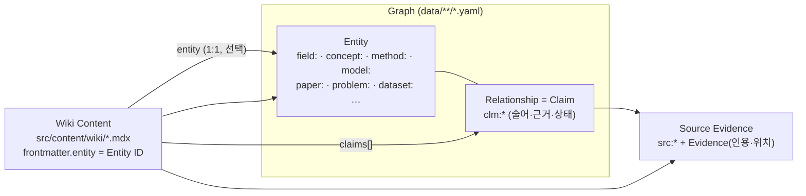
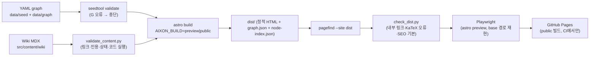

# WIKI_CONTENT_ARCHITECTURE — Knowledge Atlas + Interactive AI Wiki

> 2026-10-15 제품 방향 수정(사용자)에 따른 v0.1 아키텍처. **AIXON = AI 연구 분야 전체의 Knowledge Graph(Atlas) + 개념별 교육용 Wiki를 하나로 묶은 정적 웹사이트.** 개인 숙련도·맞춤 학습 경로·학습 이력(04 문서)은 **P2**로 미룬다.
> 관련: 스키마 [CONTENT_SCHEMA.md](CONTENT_SCHEMA.md) · 작성 기준 [EDUCATIONAL_CONTENT_GUIDELINES.md](EDUCATIONAL_CONTENT_GUIDELINES.md) · 검증 [CONTENT_VALIDATION_PLAN.md](CONTENT_VALIDATION_PLAN.md) · 결정 [DECISIONS.md](DECISIONS.md) ADR-015~018

---

## 1. 무엇이 바뀌었고 무엇이 그대로인가

| 영역 | 이전 설계(v1, 로컬 학습 앱) | v0.1(Atlas + Wiki) | 이유 |
|---|---|---|---|
| 제품 핵심 | 개인 학습 경로·숙련도 | **AI 전체 지도 + 개념 Wiki** | 사용자 결정(2026-10-15) |
| 실행 형태 | FastAPI + SQLite + SPA, localhost | **정적 사이트**(서버·DB·LLM 없음), 로컬 미리보기 + GitHub Pages | 공개 허용, 운영비 0 |
| 지식 그래프 | YAML(git) 정본 → 메모리 | **그대로**: YAML(git) 정본 → **빌드 시** 로드·검증 → 정적 페이지·JSON | 이미 정적 사이트에 맞는 구조였다 |
| 온톨로지·Claim·Evidence | 02 문서 | **그대로** + Wiki 문서라는 4번째 층 추가 | — |
| 검증 도구 | `tools/seedtool.py` | **그대로**(빌드 전 관문) + 콘텐츠 검증 추가 | — |
| 학습 엔진·숙련도 | P0 | **P2**(설계 보존, `tools/seedtool.py plan/mastery`로 기준 구현 유지) | 사용자 우선순위 |
| Interactive Lab | 학습 경로의 한 단계 | **Wiki 안의 컴포넌트**(브라우저에서만 실행) | — |

## 2. 네 개의 층과 Canonical ID

| 층 | 정본 위치 | ID | 무엇을 담나 | 무엇을 담지 않나 |
|---|---|---|---|---|
| **Graph Entity** | `data/seed/seed_graph.yaml`, `data/graph/*.yaml` | `<type>:<slug>` (02 §3) | 이름, 별칭, 한두 문장 요약, 분류(fields/parents), 식별자 | 긴 설명 |
| **Relationship (Claim)** | 같은 YAML의 `claims:` | `clm:<slug>` | 술어, 방향, qualifier, 상태, 근거 | 서술형 설명 |
| **Source Evidence** | YAML `sources:` + Claim 안 Evidence | `src:<scheme>:<id><ver>` | 문서 버전, 인용, 위치 | 원문 전문(저작권, 캐시에만) |
| **Wiki Content** | `src/content/wiki/<slug>.mdx` | `wiki:<slug>` (`frontmatter.id`) | 교육용 설명, 수식, 예제, 코드, 그림, 실험 | 관계 주장(필요하면 Claim을 참조) |

규칙:
1. **Wiki는 Graph를 바꾸지 않는다.** 문서가 "ViT는 Transformer를 비전에 적용했다"고 말하려면 해당 Claim(`clm:vit-adapts-transformer`)을 `claims:`에 걸고 `<Cite claim=…>`로 인용한다. 문서 안의 문장이 새 관계의 근거가 되지는 않는다.
2. **모든 노드에 Wiki가 필요하지는 않다.** Wiki가 없는 노드는 상태 `missing`으로 집계된다(§5).
3. **ID는 불변이다.** Wiki slug는 entity slug와 같게 둔다(`method:scaled-dot-product-attention` → `wiki/scaled-dot-product-attention`). 하나의 entity에 Wiki는 최대 하나다. 서로 다른 엔티티의 slug는 유형이 달라도 전역에서 유일해야 한다(G024, ADR-023) — 그렇지 않으면 `wiki/<slug>`가 충돌한다.
4. 문서 안의 개념 링크는 **항상 Entity ID로** 건다(`<ConceptLink id="concept:softmax">`). URL은 빌드가 만든다. 그래서 Wiki가 생기거나 없어져도 링크가 깨지지 않는다(Wiki가 있으면 Wiki로, 없으면 Entity 페이지로 간다).

## 3. 정적 사이트 아키텍처 비교 (요구사항 6)

| 기준 | React + Vite (SPA) | **Astro + MDX + React Islands** |
|---|---|---|
| 콘텐츠 관리 | MDX 플러그인, 라우팅, 메타데이터 스키마를 직접 구성해야 한다 | Content Collections가 MDX와 frontmatter 스키마(zod) 검증을 기본 제공한다. 스키마가 틀리면 빌드가 실패한다 |
| 정적 HTML 생성 | 기본은 클라이언트 렌더링. 페이지별 HTML을 만들려면 SSG 플러그인이 필요하다 | 페이지마다 완성된 HTML을 생성한다. JS 없이도 본문이 보인다 |
| SEO | 크롤러가 JS를 실행해야 내용이 보인다 | 제목·메타·본문이 HTML에 있다. sitemap 통합이 있다 |
| 그래프 상호작용 | 전부 React라서 자연스럽다 | 필요한 곳만 React island(`client:visible`)로 붙인다. Atlas·Trace·Lab이 island다 |
| GitHub Pages | 직접 링크·새로고침이 404가 된다(404.html 리다이렉트 꼼수 필요) | `build.format: "directory"` + `trailingSlash: "always"`로 각 URL이 실제 `index.html`이다. 직접 링크·새로고침이 그대로 된다. `base` 설정으로 저장소 경로를 처리한다 |
| 검색 | 클라이언트 인덱스를 직접 만들어야 한다 | 빌드 결과에 Pagefind를 돌리면 정적 전문 검색이 된다 |
| 수식·코드 | 런타임 렌더링 | 빌드 시 KaTeX(remark-math + rehype-katex), Shiki 코드 강조. 클라이언트 비용이 0 |
| 유지보수 비용 | 낮음(익숙함) | 낮음(파일 기반 라우팅, 콘텐츠 = 파일). 프레임워크가 하나 늘지만 React 지식을 그대로 쓴다 |
| 이전 설계와의 연속성 | Vite SPA + FastAPI 계획과 같다 | YAML → 빌드 시 로드 구조, React Flow·KaTeX·Lab 모듈을 그대로 쓴다 |

**결정: Astro 7 + MDX + React 19 Islands** (ADR-015). 검색은 **Pagefind**(전문 검색) + **빌드 시 생성한 노드 색인 JSON**(이름·별칭 부분 일치, 한국어 2글자 검색어 지원)이다(ADR-016). 서버·DB·LLM 없이 동작한다.

## 4. 빌드 파이프라인

- **두 가지 빌드 모드** (콘텐츠 품질 정책 §6):
  - `preview`(로컬 기본값): 모든 콘텐츠를 상태 배지와 함께 보여 준다. 사용자의 검토 작업 화면이다.
  - `public`(GitHub Pages): **사람이 승인한 것만** 내보낸다. Wiki는 `status: published`만, Claim은 `review.decision: approve`가 있는 것만, AI가 쓴 entity 요약은 `summary_review` 승인이 있는 것만 공개한다. 나머지 노드는 이름과 분류만 나오고 "준비 중"으로 표시된다.
- **base 경로**: 환경 변수 `AIXON_BASE`(로컬 `/`, GitHub Pages `/<repo>/`)와 `AIXON_SITE`(예: `https://<user>.github.io`). 모든 내부 링크는 `import.meta.env.BASE_URL`을 거친다.
- **빌드 산출물**: 페이지 HTML, `graph.json`(Atlas island용, 모드에 맞게 걸러진 그래프), `node-index.json`(빠른 노드 검색), `pagefind/`, `sitemap-index.xml`, `robots.txt`, `404.html`.

## 5. 콘텐츠 상태와 Knowledge Coverage

| 상태 | 의미 | 필요한 것 | preview | public |
|---|---|---|---|---|
| `missing` | Wiki 파일이 없다(노드만 있음) | — | Entity 페이지에 "아직 설명 없음" | 같음 |
| `outline` | 목차와 요점만 | frontmatter + 섹션 제목 | 표시(개요 배지) | 숨김 |
| `draft` | 본문 작성됨. AI가 썼을 수 있다 | 출처, 자동 검증 통과 | 표시("검토 전 초안" 배너) | 숨김 |
| `reviewed` | 사람이 내용을 검토하고 승인했다 | `review.by: human:*`, `decision: approve`, 자동 검증 통과 | 표시 | 숨김(아직 게시 결정 전) |
| `published` | 공개 결정 | reviewed + `published_at` | 표시 | **표시** |

- 상태를 올리는 것은 사람의 편집(frontmatter 수정 + 커밋)이다. 도구는 상태를 **올리지 않고** 조건 위반만 보고한다(검증기가 실패시킨다).
- **Coverage 페이지**(`/coverage/`): 분야별로 노드 수, Wiki 상태별 개수, 검증된 Claim 수, 사람 검토된 Claim 수를 보여 준다. "어디가 넓기만 하고 깊이가 없는가"를 한 화면에서 본다.

## 6. 콘텐츠 품질 정책 (요구사항 5)

1. **출처 우선순위**: 원전 논문(특정 버전) > 교재(d2l.ai, Deep Learning book 등) > 공식 문서 > 강의 노트 > 블로그. 핵심 주장과 수식에는 `<Cite>`가 있어야 한다.
2. **수식과 예제는 계산으로 확인한다.** 숫자가 나오는 예제는 문서 안 `python verify` 코드 블록의 `assert`로 확인하고, CI에서 실행한다(CONTENT_VALIDATION_PLAN V-CODE).
3. **AI 생성 콘텐츠는 자동 게시하지 않는다.** `ai_generated: true`인 문서는 사람의 `review` 없이 `reviewed`·`published`가 될 수 없고, public 빌드에 들어가지 않는다. 기계 검증(인용 원문 대조, 스키마, 계산)은 **검토를 돕는 것**이지 대신하지 않는다.
4. **저작권**: 외부 그림·문장·코드를 복사하지 않는다. 인용은 짧게(≤ 300자), 출처와 함께 둔다. 그림은 직접 만든 SVG만 쓴다(`figures[].origin: self-made`). 외부 자료는 링크로 안내한다.
5. 콘텐츠가 존재한다고 검증 상태를 주지 않는다. 상태는 §5의 조건으로만 정해진다.

## 7. 화면 구성 (05 문서를 대체하는 v0.1 IA)

| 경로 | 화면 | 핵심 내용 | Island |
|---|---|---|---|
| `/` | Atlas 홈 | 상위 분야 지도, 검색, Coverage 요약, 대표 Wiki | — |
| `/atlas/` | Interactive Atlas | 분야 계층 + 소속 노드를 점진적으로 펼치는 그래프, 유형·검증 상태 필터, 노드 패널(→ Entity/Wiki) | `AtlasExplorer` |
| `/fields/<slug>/` | 분야 | 요약, 하위 분야, 대표 개념·모델·논문, 연구 문제, 관련 분야 | — |
| `/e/<type>/<slug>/` | Entity | 요약(AI 초안 표시), Wiki 링크·상태, **관계(Claim) 목록과 상태 배지**, 검증된 선수 개념(차원별), 구성 요소, 제시 논문, 지역 그래프 | `LocalGraph` |
| `/wiki/<slug>/` | Wiki | 단계 전환(직관 → 기초 → 심화), 목차, 본문(수식·코드·그림·실험), 관련 개념, **참고문헌·근거**(자동 생성) | `SoftmaxTemperatureLab` 등 |
| `/claims/<slug>/` | Evidence Inspector | 관계 문장, 술어 정의, 상태·검증·사람 검토, 인용·위치·원문 링크(text fragment), 이력 | — |
| `/trace/` | 연구 계보 | 시간축 계보(CV 슬라이스), 술어 필터, 간선 → Claim 페이지 | `TraceTimeline` |
| `/coverage/` | Coverage | §5 | — |
| `/search/` | 검색 | Pagefind UI + 노드 바로가기 | Pagefind UI |
| `/about/` | 방법론 | 온톨로지, 검증 정책, 상태, AI 콘텐츠 정책 | — |

모바일은 읽기 화면(Wiki, Entity, 분야, Claim)을 우선 지원한다. Atlas·Trace의 그래프는 데스크톱에서 쓰는 것을 우선으로 하고, 모바일에서는 같은 내용을 **목록 보기**로 보여 준다(05 §4.5 접근성 원칙 유지).

## 8. 대표 Concept Wiki 페이지 설계: Scaled Dot-Product (Self-)Attention

선정 이유: 시드 그래프에서 근거가 가장 촘촘하고(Transformer §3.2, 각주 4, ViT §3.1), 계산으로 검증할 수 있는 예제와 이미 검증한 Lab(05 §5.3, fixture)이 있다. ViT·BERT·Swin으로 바로 이어진다.

| 섹션 | 단계 | 내용 | 검증 |
|---|---|---|---|
| Overview & Intuition | 직관 | "query가 key들에게 얼마나 관련 있는지 물어 value를 섞는다" — 도서관 비유 대신 실제 토큰 예 | — |
| Why It Matters | 직관 | Transformer·BERT·ViT의 공통 부품. RNN 순차 계산 문제(Claim) | `clm:transformer-addresses-sequential` |
| Core Mechanism | 기초 | QKᵀ → 스케일 → softmax → V 가중합, 행렬 모양 | `clm:intro-sdpa`, 선수 Claim P1–P3 |
| Mathematical Foundations | 기초·심화 | 식, softmax 성질(합 1, shift invariance), **√d_k 유도**(분산 = d_k) | `clm:prereq-variance-of-sum…`, 각주 4 인용 |
| Step-by-step Example | 기초 | 토큰 3개, d_k = 2인 Q·K·V 손계산 표 | `python verify` assert |
| Implementation / Code | 기초 | numpy 10줄 구현 + 안정적 softmax | `python verify` assert |
| Visual Explanation | 직관 | 직접 만든 SVG(행렬 흐름도) + **SoftmaxTemperatureLab** | Lab fixture(L1–L7) |
| Limitations & Trade-offs | 심화 | n²(Table 1), 순서 정보 없음 → positional encoding, 포화 | `clm:transformer-mitigates-sequential`, P20 |
| Historical Development | 심화 | additive(Bahdanau 2014) → dot-product + scaling(2017) → 비전(ViT, Swin) | 연구 Claim들 |
| Related Concepts / Papers | — | Graph에서 자동 생성(선수·구성·IS_A) | 빌드 |
| References & Evidence | — | 인용된 Source·Claim 자동 목록 | 빌드 |

## 9. Graph–Wiki 통합 E2E 시나리오 (요약)

자세한 단계와 기대 결과는 CONTENT_VALIDATION_PLAN.md의 E2E-1.

1. 홈 → 검색에서 "어텐션" 입력 → 노드 바로가기에서 Scaled Dot-Product Attention 선택
2. Entity 페이지 → "Wiki 읽기" → 단계 전환(직관 → 기초) → 수식이 렌더링되었는지(KaTeX), 코드 블록이 있는지 확인
3. Lab에서 온도 슬라이더 조작 → 화면의 확률 값이 독립 계산(fixture)과 일치하는지 확인
4. 본문의 `<ConceptLink>` "softmax" → softmax Entity 페이지(Wiki 없음이면 `missing` 표시) → "그래프에서 보기" → Atlas에서 해당 노드가 선택된 상태로 열림
5. Atlas에서 노드 패널의 관계 → Claim 페이지(Evidence Inspector)에서 인용과 원문 링크 확인
6. 이 URL을 새 탭으로 직접 열고 새로고침 → 같은 화면(base 경로 포함)
