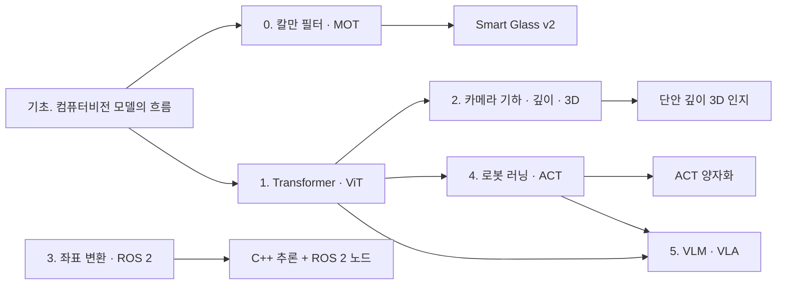

# 📚 Physical AI 공부 로드맵 — CV·엣지 AI에서 로봇 인지·정책까지

<!-- Source: Notion page https://app.notion.com/p/3f96adcb5c5981b488f2ff60356a4634 (fetched 2026-10-15, last edited 2026-10-14T11:54:30Z). Verbatim content; Notion color annotations removed. -->

> 처음 공부하는 사람도 따라올 수 있게 무엇을, 왜, 어떤 순서로, 무엇으로 배우는지 정리한 계획입니다. 단계마다 실제로 진행할 프로젝트와 맞물려 있어서, 공부한 것이 바로 결과물로 남습니다.

## 한눈에 보기

| 단계 | 무엇을 | 왜 (어디에 쓰나) | 권장 기간 |
|---|---|---|---|
| 기초 | 컴퓨터비전 모델의 흐름: 백본 · 탐지 · 세그멘테이션 · 추적 | 모든 단계의 바탕. CV 면접 단골 개념(IoU · NMS · anchor · mAP) | 1–2주 |
| 0 | 칼만 필터 · 다중 객체 추적(MOT) | Smart Glass v2의 고스트 박스를 추적으로 바꾸기 | 1주 |
| 1 | Transformer → ViT → DETR | 깊이 모델 · ACT · VLM이 모두 이 구조 위에 있음 | 1–2주 |
| 2 | 카메라 기하 → 깊이 추정 → 3D | 단안 깊이 3D 인지 프로젝트 | 2주 |
| 3 | 로봇 기초: 좌표 변환 · ROS 2 | C++ 추론 + ROS 2 노드 프로젝트 | 1–2주 (2단계와 병행 가능) |
| 4 | 로봇 러닝 → ACT | ACT 정책 양자화 프로젝트 | 2–3주 |
| 5 | VLM → VLA | 대학원 연구 방향, 스마트글래스 VLM 확장 | 2주 이상 (읽기 위주) |

기간은 하루 2–3시간 기준의 대략적인 권장치입니다. 프로젝트 일정에 맞춰 늘리거나 줄여도 됩니다.



## 공부하는 법

### 논문은 세 번에 나눠 읽기
1. 처음 10분: 초록, 그림 1, 결과 표만 봅니다. "무엇을 풀었고 얼마나 좋아졌나"만 잡습니다.
2. 두 번째: 방법의 큰 그림(모델 그림과 학습 방식)을 이해합니다. 수식은 건너뛰어도 됩니다.
3. 세 번째: 직접 구현하거나 코드를 읽을 때 필요한 부분만 깊게 봅니다.

### 노트는 다섯 줄로
```
1. 무엇을 풀었나:
2. 이전 방법은 왜 부족했나:
3. 핵심 아이디어 한 줄:
4. 실험으로 보여 준 것 (수치 하나):
5. 내 프로젝트에 쓸 점:
```

### 막힐 때
- 개념이 안 잡히면 그림으로 설명한 글(아래 자료의 블로그·강의)부터 봅니다.
- 코드가 안 읽히면 입력과 출력의 텐서 모양(shape)부터 적어 봅니다.
- 하루 이상 막히면 다음 단계로 넘어갔다가 돌아옵니다. 순서보다 계속 진도가 나가는 게 중요합니다.

---

## 기초 단계 — 컴퓨터비전 모델의 흐름 (백본 · 탐지 · 세그멘테이션 · 추적)

> 한 줄 요약: 모델 이름을 외우는 게 아니라 "앞 모델의 어떤 문제를 다음 모델이 풀었나"의 흐름을 잡습니다. 이미 써 본 모델(SSD, Faster R-CNN, YOLOX, YOLO11, BiSeNetV2 등)이 그 흐름의 어디에 있는지 알게 됩니다.

**왜 배우나**: 뒤의 모든 단계가 이 위에 있고, CV 직무 면접에서 가장 자주 묻는 개념(IoU, NMS, anchor, mAP, FPN)이 여기에 다 들어 있습니다. 처음부터 완벽히 알 필요는 없고, 지도를 한 장 그려 두는 게 목표입니다.

### 흐름 한 장으로 보기

| 갈래 | 흐름 | 각 단계가 푼 문제 |
|---|---|---|
| 백본 (특징 뽑기) | AlexNet → VGG → ResNet → MobileNet · EfficientNet → ViT · DINOv2 | 깊게 쌓기 → 깊어도 학습되게(잔차 연결) → 가볍게(엣지용) → Transformer로 넓게 보기 |
| 2단계 탐지 | R-CNN → Fast R-CNN → Faster R-CNN | 후보 영역을 먼저 찾고 분류. 정확하지만 느림. Faster R-CNN은 후보 찾기도 신경망(RPN)으로 |
| 1단계 탐지 | YOLO v1 → SSD → RetinaNet → FCOS · YOLOX → YOLOv8–11 | 후보 단계 없이 한 번에(빠름) → 쉬운 배경에 덜 휘둘리게(focal loss) → anchor 없이 → 정답 박스 배정 방식 개선 |
| Transformer 탐지 | DETR → RT-DETR | query마다 박스를 바로 예측, NMS가 필요 없음 → 실시간 속도로 |
| 세그멘테이션 | FCN → U-Net → DeepLab → BiSeNet · PP-LiteSeg | 픽셀마다 분류 → 해상도 되살리기 → 넓은 문맥 보기 → 실시간용 구조 |
| 추적 | SORT → DeepSORT → ByteTrack → OC-SORT · BoT-SORT | 칼만 + IoU → 외형 특징(ReID) 추가 → 낮은 점수 탐지 재활용 → 가림·카메라 움직임 보정 |

### 핵심 개념
- **백본 · 넥 · 헤드**: 특징을 뽑는 부분(백본), 여러 크기의 특징을 섞는 부분(넥, 예: FPN), 박스와 클래스를 내는 부분(헤드).
- **1단계와 2단계 탐지기**: 후보 영역을 먼저 고르고 분류하면 2단계(정확, 느림), 한 번에 박스와 클래스를 내면 1단계(빠름).
- **Anchor**: 미리 정해 둔 여러 크기·비율의 기준 박스. 모델은 "이 기준 박스를 얼마나 옮기고 늘리면 물체에 맞나"를 예측합니다. FCOS와 YOLOX는 anchor 없이 바로 예측합니다(anchor-free).
- **NMS**: 같은 물체에 겹쳐 나온 여러 박스 중 점수가 가장 높은 것만 남기는 후처리.
- **FPN**: 깊은 층(의미는 강하지만 흐릿함)과 얕은 층(선명하지만 의미가 약함)을 섞어, 작은 물체와 큰 물체를 함께 잘 잡게 하는 구조.
- **mAP**: 탐지 성능의 표준 지표. 클래스마다 정밀도-재현율 곡선 아래 면적(AP)을 구해 평균합니다. COCO의 AP(0.50:0.95)는 IoU 기준을 0.5부터 0.95까지 바꿔 가며 평균한 값입니다.

### 순서대로 볼 자료
1. [Lilian Weng, Object Detection Part 3: R-CNN Family](https://lilianweng.github.io/posts/2017-12-31-object-recognition-part-3/) · [Part 4: Fast Detection Models](https://lilianweng.github.io/posts/2018-12-27-object-recognition-part-4/) — 2단계와 1단계 탐지기의 흐름을 그림으로. 가장 먼저.
2. [Dive into Deep Learning, 14장 Computer Vision](https://d2l.ai/chapter_computer-vision/index.html) — anchor, SSD, R-CNN, 세그멘테이션을 코드와 함께 설명하는 무료 교재.
3. [Stanford CS231n](https://cs231n.stanford.edu/) — 강의 노트와 영상. 탐지·세그멘테이션 강의 위주로.
4. 논문은 초록과 그림 1만: [ResNet](https://arxiv.org/abs/1512.03385) · [Faster R-CNN](https://arxiv.org/abs/1506.01497) · [YOLO v1](https://arxiv.org/abs/1506.02640) · [SSD](https://arxiv.org/abs/1512.02325) · [FPN](https://arxiv.org/abs/1612.03144) · [RetinaNet(Focal Loss)](https://arxiv.org/abs/1708.02002) · [FCOS](https://arxiv.org/abs/1904.01355) · [YOLOX](https://arxiv.org/abs/2107.08430) · [DeepSORT](https://arxiv.org/abs/1703.07402)

### 손으로 해 볼 것 (면접 단골)
- [ ] numpy로 IoU 계산 함수 직접 짜기
- [ ] numpy로 NMS 직접 짜기
- [ ] 탐지 결과와 정답으로 AP를 직접 계산해 보고 pycocotools 결과와 비교
- [ ] 이미 써 본 모델(SSD · Faster R-CNN · YOLOX · YOLO11 · BiSeNetV2)을 위 표의 어디에 놓을지 노트에 적기

### 다음 단계로 가기 전 체크
- [ ] 1단계와 2단계 탐지기, anchor와 anchor-free의 차이를 설명할 수 있다
- [ ] NMS와 mAP를 계산하는 과정을 말로 설명할 수 있다

## 0단계 — 칼만 필터와 다중 객체 추적 (MOT)

> 한 줄 요약: 탐지가 잠깐 끊겨도, 물체가 움직이던 방향과 속도로 다음 위치를 예측해 박스를 이어 가는 방법.

**왜 배우나**: Smart Glass는 추적이 느려서 "마지막 탐지 결과를 그대로 유지"(고스트 박스)했습니다. 그러면 고개를 돌릴 때 박스가 제자리에 남아 대상에서 어긋납니다. 칼만 필터는 연산이 아주 가벼워서 이 문제를 직접 풀 수 있습니다. 다만 카메라가 머리와 함께 움직이는 안경에서는 칼만만으로는 고스트가 줄지 않았고, 카메라 움직임 보정을 더해야 줄었습니다(Smart Glass v2 v0.1, 2026-10-14: 같은 4프레임 검출 간격에서 고스트 16.3% → 11.0%).

### 핵심 개념
- **칼만 필터**: "예측"과 "측정"을 섞는 방법. 직전 위치·속도로 지금 위치를 예측하고, 새 측정(탐지 박스)이 오면 둘을 믿을 만한 정도에 따라 섞어 보정합니다. 측정이 없으면 예측만으로 이어 갑니다.
- **다중 객체 추적(MOT)**: 화면 속 여러 물체에 번호(ID)를 붙이고, 프레임이 바뀌어도 같은 물체에 같은 번호를 유지하는 일.
- **짝짓기(association)**: 예측한 박스와 새로 탐지한 박스 중 어느 것이 같은 물체인지 정하는 단계. 박스가 얼마나 겹치는지(IoU)를 보고, 헝가리안 알고리즘으로 가장 잘 맞는 짝을 고릅니다.
- **SORT**: 칼만 예측 + IoU 짝짓기만으로 만든 가장 단순하고 빠른 추적기.
- **ByteTrack**: 확신이 낮은 탐지도 버리지 않고 두 번째 짝짓기에 써서, 가려진 물체를 덜 놓치는 추적기.
- **카메라 움직임 보정(CMC)**: 카메라 자체가 움직이면(머리에 쓴 안경, 손에 든 폰) 화면 속 모든 물체가 함께 움직여 보여서, "등속으로 움직인다"는 칼만 예측이 빗나갑니다. 프레임 사이 화면 전체의 움직임(optical flow 등)을 먼저 구해 보정한 뒤 예측합니다. BoT-SORT가 이 방식을 씁니다.
- **트랙 수명과 안내 대상 고르기**: 탐지가 끊긴 트랙을 예측만으로 몇 프레임까지 이어 갈지(SORT의 max_age), 새 트랙을 몇 번 확인해야 믿을지(min_hits)를 정합니다. 여러 트랙 중 안내할 하나를 고를 때 예측만으로 버티는 낡은 트랙을 막 검출된 트랙보다 앞세우면 고스트가 늘어납니다(Smart Glass v2에서 실제로 겪은 결함, 2026-10-14).
- **평가 지표**: IDF1(같은 물체에 같은 번호를 얼마나 잘 유지했나), HOTA(탐지와 연결을 함께 보는 종합 점수), ID switch(번호가 바뀐 횟수).

### 순서대로 볼 자료
1. [How a Kalman filter works, in pictures](https://www.bzarg.com/p/how-a-kalman-filter-works-in-pictures/) — 그림으로 보는 칼만 필터. 수식보다 이것부터.
2. [SORT 논문](https://arxiv.org/abs/1602.00763) — 짧은 논문. 칼만 + IoU 짝짓기가 전부라는 걸 확인합니다.
3. [ByteTrack 논문](https://arxiv.org/abs/2110.06864) — "낮은 점수 탐지를 다시 쓰기" 하나만 이해하면 됩니다.
4. [HOTA 논문](https://arxiv.org/abs/2009.07736) · [TrackEval](https://github.com/JonathonLuiten/TrackEval) — 지표의 뜻과 계산 도구.

### 손으로 해 볼 것
- [ ] numpy로 1차원 칼만 필터(위치·속도)를 직접 구현하고, 노이즈 섞인 측정에서 예측선이 매끄러워지는지 그래프로 확인
- [ ] 박스(중심 x, y, 크기)로 확장해 SORT를 따라 만들기
- [ ] Smart Glass v2의 실험 E2(칼만 + IoU)에 그대로 쓰기

### 다음 단계로 가기 전 체크
- [ ] 고스트 박스와 칼만 추적의 차이를 말로 설명할 수 있다
- [ ] IDF1과 ID switch가 무엇을 재는지 설명할 수 있다
- [ ] 카메라가 움직일 때 칼만만으로 왜 부족한지, CMC가 그걸 어떻게 보정하는지 설명할 수 있다

## 1단계 — Transformer → ViT → DETR

> 한 줄 요약: 요즘 거의 모든 비전·언어·로봇 모델의 공통 뼈대. 이미지를 작은 조각으로 잘라 "단어"처럼 다룹니다.

**왜 배우나**: 2단계의 Depth Anything(이미지 인코더가 ViT), 4단계의 ACT(Transformer 인코더-디코더), 5단계의 VLM·VLA가 모두 이 구조 위에 있습니다. 한 번 배우면 세 곳에 씁니다.

### 핵심 개념
- **토큰**: 모델이 다루는 조각 단위. 문장은 단어 조각, 이미지는 작은 사각형 조각(패치)으로 나눕니다.
- **어텐션(attention)**: 각 토큰이 다른 모든 토큰을 얼마나 참고할지 스스로 정하는 방식. CNN이 가까운 픽셀만 보는 것과 달리 처음부터 이미지 전체를 봅니다.
- **인코더 · 디코더**: 인코더는 입력을 이해한 표현으로 바꾸고, 디코더는 그 표현을 보며 출력을 만듭니다.
- **ViT**: 이미지를 16×16 패치로 잘라 한 줄로 늘어놓고 Transformer 인코더에 넣는 분류 모델.
- **DETR**: 탐지를 "정해진 개수의 질문(query)에 답하기"로 바꾼 Transformer 탐지기. 질문마다 박스 하나를 답해서 NMS가 필요 없습니다. ACT의 구조가 여기서 나왔습니다.

### 순서대로 볼 자료
1. [The Illustrated Transformer](https://jalammar.github.io/illustrated-transformer/) — 그림으로 보는 Transformer. 가장 먼저.
2. [Andrej Karpathy, Let's build GPT](https://www.youtube.com/watch?v=kCc8FmEb1nY) — 어텐션을 코드로 직접 짜 보는 강의(약 2시간).
3. [Attention Is All You Need](https://arxiv.org/abs/1706.03762) — 원 논문. 1·2를 본 뒤 그림 1만 다시 이해하면 충분합니다.
4. [ViT 논문](https://arxiv.org/abs/2010.11929) — 그림 1과 "패치 임베딩"이 핵심.
5. [DETR 논문](https://arxiv.org/abs/2005.12872) — object query와 "집합 예측"이 핵심.

### 손으로 해 볼 것
- [ ] 작은 ViT를 직접 짜서 CIFAR-10 분류 학습 (RTX 3070으로 충분)
- [ ] timm 라이브러리의 ViT 코드에서 패치 임베딩 부분 읽기
- [ ] 공개된 DETR 가중치로 사진 몇 장을 탐지해 보고 YOLO 결과와 비교

### 다음 단계로 가기 전 체크
- [ ] 어텐션이 CNN과 무엇이 다른지 설명할 수 있다
- [ ] 이미지가 ViT에 들어가 토큰이 되는 과정을 텐서 모양으로 말할 수 있다

## 2단계 — 카메라 기하 → 깊이 추정 → 3D

> 한 줄 요약: 사진 한 장의 각 픽셀이 카메라에서 얼마나 떨어져 있는지 예측하고, 그걸 3D 점들(포인트클라우드)로 바꿉니다.

**왜 배우나**: 로봇과 안경은 "무엇이 있나"뿐 아니라 "얼마나 멀리, 어디에 있나"를 알아야 움직일 수 있습니다. 단안 깊이 3D 인지 프로젝트의 바탕이고, 3D·센서 퓨전 채용 키워드로 이어집니다.

### 핵심 개념
- **핀홀 카메라 모델**: 3D 공간의 점이 작은 구멍을 지나 이미지 평면에 맺히는 방식. 3D → 2D 변환을 식 하나로 씁니다.
- **내부 파라미터**: 초점거리, 이미지 중심 등 카메라 자체의 특성. 체커보드로 잴 수 있습니다(캘리브레이션).
- **외부 파라미터**: 카메라가 세상의 어디에, 어느 방향으로 있는지.
- **역투영**: 픽셀 위치 + 깊이 → 3D 점. 이걸 모든 픽셀에 하면 포인트클라우드가 됩니다.
- **상대 깊이와 절대 깊이**: "어느 쪽이 더 가깝나"만 아는 것과 "몇 미터인가"까지 아는 것. 단안 모델은 대부분 상대 깊이라서 스케일을 따로 맞춰야 합니다.
- **평가 지표**: AbsRel(실제 거리 대비 평균 오차 비율), δ1(오차가 25% 안에 드는 픽셀 비율).
- **DPT · Depth Anything**: ViT 인코더로 이미지를 이해하고, 여러 층의 특징을 합쳐 픽셀마다 깊이를 내는 모델.

### 순서대로 볼 자료
1. [OpenCV 카메라 캘리브레이션 튜토리얼](https://docs.opencv.org/4.x/dc/dbb/tutorial_py_calibration.html) — 내부 파라미터를 직접 재 보며 개념 잡기.
2. [Szeliski, Computer Vision: Algorithms and Applications (무료 온라인)](https://szeliski.org/Book/) — 2장(이미지 형성)과 12장(깊이 추정) 위주. 사전처럼 찾아봅니다.
3. [Cyrill Stachniss 강의 (YouTube)](https://www.youtube.com/@CyrillStachniss) — 카메라 모델·SLAM 강의가 쉽고 정확합니다.
4. [MiDaS](https://arxiv.org/abs/1907.01341) → [DPT](https://arxiv.org/abs/2103.13413) → [Depth Anything](https://arxiv.org/abs/2401.10891) → [Depth Anything V2](https://arxiv.org/abs/2406.09414) — 이 순서로 "무엇이 나아졌나"만 따라갑니다.

### 손으로 해 볼 것
- [ ] 폰 카메라나 웹캠을 체커보드로 캘리브레이션
- [ ] Depth Anything V2-Small로 내 사진의 깊이맵 만들기
- [ ] 캘리브레이션 값으로 역투영해 포인트클라우드를 Open3D로 보기
- [ ] KITTI 몇 장으로 AbsRel · δ1 계산해 보기 → 단안 깊이 3D 인지 프로젝트로 이어짐

### 다음 단계로 가기 전 체크
- [ ] 픽셀 하나를 3D 점으로 바꾸는 식을 손으로 쓸 수 있다
- [ ] 단안 깊이가 왜 실제 거리(스케일)를 모르는지 설명할 수 있다

## 3단계 — 로봇 기초: 좌표 변환과 ROS 2

> 한 줄 요약: 카메라가 본 것을 로봇이 쓸 수 있는 좌표와 메시지로 바꾸는 법.

**왜 배우나**: 인지 결과는 로봇 소프트웨어 안에서 다른 부품(계획·제어)이 받아 써야 의미가 있습니다. ROS 2는 그 부품들을 잇는 사실상의 표준이고, C++ 추론 + ROS 2 노드 프로젝트에 바로 쓰입니다.

### 핵심 개념
- **좌표 변환**: 카메라 기준 좌표를 로봇 몸체 기준, 지도 기준으로 바꾸는 계산. 회전과 이동을 4×4 행렬 하나로 묶어 씁니다(동차 좌표).
- **ROS 2**: 로봇 프로그램을 작은 프로그램(노드)들로 나누고, 노드끼리 토픽으로 메시지를 주고받게 하는 틀.
- **노드 · 토픽 · 메시지**: 노드는 일하는 단위, 토픽은 메시지가 오가는 채널, 메시지는 정해진 형식의 데이터(이미지, 점군 등).
- **rosbag**: 토픽에 오간 메시지를 녹화해 두었다가 그대로 재생하는 파일. 실제 로봇 없이 개발할 때 핵심입니다.
- **tf**: ROS 2에서 좌표 변환을 관리하는 기능.

### 순서대로 볼 자료
1. [ROS 2 Humble 공식 튜토리얼](https://docs.ros.org/en/humble/Tutorials.html) — Beginner의 CLI tools, Client libraries까지.
2. [Modern Robotics (무료 교재·강의)](http://hades.mech.northwestern.edu/index.php/Modern_Robotics) — 3장(강체 운동)만 먼저. 동역학·제어는 개념만 봅니다.

### 손으로 해 볼 것
- [ ] WSL2(Ubuntu 22.04)에 ROS 2 Humble 설치, 튜토리얼의 talker · listener 실행
- [ ] 영상 파일을 이미지 토픽으로 바꿔 rosbag으로 녹화하고 재생
- [ ] 이미지를 받아 흑백으로 바꿔 다시 내보내는 노드를 C++로 작성 → C++ 추론 + ROS 2 노드 프로젝트의 골격

### 다음 단계로 가기 전 체크
- [ ] 카메라 좌표의 점을 로봇 좌표로 바꾸는 변환을 설명할 수 있다
- [ ] 노드 · 토픽 · bag의 관계를 그림으로 그릴 수 있다

## 4단계 — 로봇 러닝 → ACT

> 한 줄 요약: 사람이 로봇을 움직여 보인 시연을 보고, 카메라 영상만으로 같은 동작을 해내는 정책을 학습합니다.

**왜 배우나**: Physical AI에서 컴퓨터공학 전공자가 주도하는 핵심 영역입니다. 동역학 모델 없이 데이터와 학습으로 풀고, 지금까지 해 온 양자화·엣지 배포 경험을 "정책 네트워크"에 그대로 적용할 수 있습니다(ACT 양자화 프로젝트).

### 핵심 개념
- **정책(policy)**: 관측(카메라 영상, 관절 상태)을 받아 행동(관절 명령)을 내는 함수.
- **행동 복제(Behavior Cloning)**: 시연 데이터의 (관측, 행동) 쌍으로 지도학습하는 가장 단순한 방법. 작은 실수가 쌓여 처음 보는 상황으로 흘러가는 문제(compounding error)가 있습니다.
- **Action chunking**: 한 번에 한 동작이 아니라 앞으로의 k개 동작을 묶어서 예측. 실수가 덜 쌓이고 동작이 부드러워집니다. ACT의 핵심입니다.
- **CVAE**: 같은 상황에서도 시연자마다 조금씩 다르게 움직이는 "스타일"을 따로 담아, 평균을 내다 동작이 흐려지는 걸 막는 생성 모델.
- **Diffusion Policy**: 노이즈에서 시작해 여러 번 다듬어 행동을 만드는 방식. 정답 동작이 여러 개인 과제에 강합니다.
- **성공률**: 로봇 정책의 기본 지표. 같은 과제를 N번 시켜 몇 번 성공했는지.

### 순서대로 볼 자료
1. [ALOHA · ACT 프로젝트 페이지](https://tonyzhaozh.github.io/aloha/) — 영상으로 무엇을 하는지 먼저 봅니다.
2. [ACT 논문](https://arxiv.org/abs/2304.13705) — action chunking, temporal ensembling, CVAE 구조 그림.
3. [Diffusion Policy](https://diffusion-policy.cs.columbia.edu/) — ACT와 무엇이 다른지 비교하며 봅니다.
4. [LeRobot 문서](https://huggingface.co/docs/lerobot) · [GitHub](https://github.com/huggingface/lerobot) — 실습 도구. 시뮬레이션 환경(gym-pusht, gym-aloha)과 공개 데이터셋이 들어 있습니다.

### 손으로 해 볼 것
- [ ] LeRobot을 설치하고 공개 데이터셋으로 ACT 학습 예제 실행 (ACT 학습은 GPU 메모리 2–6GB 정도로 알려져 있음)
- [ ] 시뮬레이션에서 성공률을 재고 기록
- [ ] 학습된 정책을 ONNX로 내보내 추론 속도 재기 → ACT 양자화 프로젝트(FP16·INT8에서 성공률이 어떻게 변하나)로 이어짐

### 다음 단계로 가기 전 체크
- [ ] 행동 복제의 누적 오류 문제와, action chunking이 그걸 어떻게 줄이는지 설명할 수 있다
- [ ] ACT의 입력과 출력을 텐서 모양으로 말할 수 있다

## 5단계 — VLM → VLA

> 한 줄 요약: 이미지와 글을 함께 이해하는 모델(VLM)에 "행동" 출력을 붙이면, 말로 시킨 일을 보고 이해하고 움직이는 모델(VLA)이 됩니다.

**왜 배우나**: 로봇 분야에서 가장 빠르게 움직이는 흐름이고, 대학원 연구 방향(온디바이스 VLA 추론)과 스마트글래스의 VLM 확장에 직접 이어집니다. 다만 큰 모델은 RTX 3070(8GB)으로 미세조정하기 어려워 읽기와 작은 실습 위주로 합니다.

### 핵심 개념
- **CLIP**: 이미지와 글을 같은 공간에 놓고 "이 사진에 맞는 설명"을 고르게 학습한 모델. 학습하지 않은 클래스도 이름만으로 분류할 수 있습니다(zero-shot).
- **VLM**: 이미지 인코더(대개 ViT) + 연결층 + 대형 언어 모델. 사진을 보고 질문에 글로 답합니다(LLaVA 등).
- **VLA**: VLM이 글 대신 로봇 행동을 출력하게 만든 모델(RT-2, OpenVLA, π0, SmolVLA).
- **행동을 내는 방법**: 행동을 숫자 토큰으로 바꿔 글처럼 생성하거나(RT-2, OpenVLA), 행동 전용 출력부를 따로 붙입니다(π0, SmolVLA).
- **엣지 문제**: VLA는 수십억 파라미터라 로봇 위에서 느립니다. 양자화·경량화·비동기 실행이 활발한 연구 주제이고, 지금까지의 경험과 가장 가까운 지점입니다.
- **환각(hallucination)**: VLM은 화면에 없는 것도 있다고 답합니다. Smart Glass v2에서 Qwen3-VL-2B는 "보이지 않으면 null" 선택지를 줘도 249번 중 한 번도 고르지 않았습니다(2026-10-14). 그래서 VLM이 제안하고 검출기 · 추적이 확인한 것만 안내하는 검증 경로를 둡니다. "보이나?"를 먼저 묻는 두 단계 질문만으로도 목표가 없는데 있다고 한 답이 26번 중 26번에서 7번으로 줄었고, 트랙 확인까지 더하면 안내한 것 중 틀린 것은 7%였습니다(대신 질문의 절반쯤은 안내하지 않음).

### 순서대로 볼 자료
1. [Hugging Face, Vision Language Models Explained](https://huggingface.co/blog/vlms) — VLM 개요를 쉽게.
2. [CLIP](https://arxiv.org/abs/2103.00020) → [LLaVA](https://arxiv.org/abs/2304.08485) — VLM의 기본 두 편.
3. [RT-2](https://arxiv.org/abs/2307.15818) → [OpenVLA](https://arxiv.org/abs/2406.09246) → [π0](https://arxiv.org/abs/2410.24164) → [SmolVLA](https://arxiv.org/abs/2506.01844) — 행동을 내는 방식이 어떻게 바뀌었나 따라갑니다.

### 손으로 해 볼 것
- [ ] CLIP으로 내 사진을 zero-shot 분류해 보기
- [ ] 작은 VLM(SmolVLM, Moondream 등)을 PC에서 돌려 사진에 질문해 보고 응답 시간 재기
- [ ] OpenVLA나 SmolVLA의 구조 그림을 보고 어디를 양자화하면 좋을지 메모 → ACT 양자화 다음 단계 후보

### 다음 단계로 가기 전 체크
- [ ] VLM과 VLA의 차이를 한 문장으로 말할 수 있다
- [ ] VLA를 로봇 위에서 돌리기 어려운 이유를 숫자(파라미터 수, 메모리)로 설명할 수 있다

---

## 용어집

| 용어 | 쉬운 설명 |
|---|---|
| 백본 · 넥 · 헤드 | 특징을 뽑는 부분, 여러 크기의 특징을 섞는 부분, 박스와 클래스를 내는 부분 |
| Anchor | 미리 정해 둔 기준 박스. 모델은 이 박스를 얼마나 옮기고 늘릴지 예측함 |
| NMS | 겹친 박스들 중 점수가 가장 높은 것만 남기는 후처리 |
| FPN | 깊은 층과 얕은 층의 특징을 섞어 큰 물체와 작은 물체를 함께 잡는 구조 |
| mAP | 탐지 성능 지표. 클래스별 정밀도-재현율 곡선 아래 면적의 평균 |
| 칼만 필터 | 예측과 측정을 믿을 만한 정도에 따라 섞어 위치를 추정하는 방법 |
| MOT | 여러 물체에 번호를 붙여 프레임이 바뀌어도 같은 번호를 유지하는 일 |
| IoU | 두 박스가 겹치는 면적 ÷ 두 박스를 합친 면적. 1이면 완전히 같음 |
| IDF1 · HOTA | 추적이 같은 물체에 같은 번호를 얼마나 잘 유지했는지 보는 점수 |
| 토큰 · 패치 | 모델이 다루는 조각. 이미지에서는 작은 사각형 조각(패치) |
| 어텐션 | 각 조각이 다른 조각을 얼마나 참고할지 스스로 정하는 계산 |
| 인코더 · 디코더 | 입력을 이해하는 부분과, 그 이해를 보고 출력을 만드는 부분 |
| ViT | 이미지를 패치로 잘라 Transformer에 넣는 모델 |
| DETR | 정해진 개수의 질문(query)마다 박스 하나를 답하는 Transformer 탐지기 |
| 내부 · 외부 파라미터 | 카메라 자체의 특성(초점거리 등)과, 카메라의 위치·방향 |
| 역투영 | 픽셀 위치와 깊이로 3D 점을 계산하는 것 |
| 포인트클라우드 | 3D 점들의 모음. LiDAR나 깊이 추정으로 얻음 |
| AbsRel · δ1 | 깊이 추정의 오차 비율, 그리고 오차가 25% 안에 드는 픽셀 비율 |
| 노드 · 토픽 · rosbag | ROS 2의 일하는 단위, 메시지 채널, 메시지 녹화 파일 |
| 정책 | 관측을 받아 행동을 내는 함수 |
| 행동 복제 | 사람의 시연을 지도학습으로 따라 하는 방법 |
| Action chunk | 앞으로의 여러 동작을 한 번에 묶어 예측한 것 |
| CVAE | 같은 상황의 여러 가능한 동작(스타일)을 따로 담는 생성 모델 |
| Zero-shot | 학습하지 않은 대상을 이름이나 설명만으로 맞히는 것 |
| VLM · VLA | 이미지와 글을 이해해 글로 답하는 모델, 그리고 행동까지 내는 모델 |
| 양자화 | 모델의 숫자 정밀도를 낮춰(FP32 → FP16 · INT8) 빠르고 가볍게 만드는 것 |

---

2026-10-14 작성 · keeweon-portfolio 오케스트레이터(Claude). 프로젝트 자체의 계획은 각 프로젝트 문서를 따릅니다(Smart Glass v2는 `~/smartglass/PLAN.md`).
